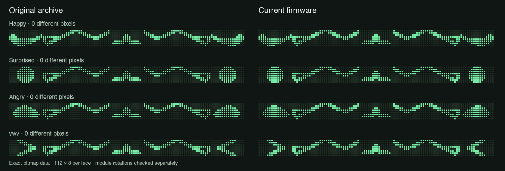

# Original four faces: archive comparison

**All four resting faces match exactly.** The comparison uses archive/PROT_OS7_original.zip itself, not the pre-upgrade working copy. No face artwork was changed to obtain the result.

| Face | Different logical pixels, out of 896 | Different physical pixels, out of 896 |
| --- | ---: | ---: |
| Happy | 0 | 0 |
| Surprised | 0 | 0 |
| Angry | 0 | 0 |
| vwv | 0 | 0 |



## How it was checked

The script reads the archived Icons.h and main sketch directly from the ZIP. It decodes the binary bitmap literals, reads the archive's six placement coordinates and its expression-selection drawing calls, and reconstructs each complete 112×8 logical face. Speech, glitches, boop, eyelids, and idle motion are inactive for this comparison.

It separately compiles the current FaceRenderer and MAX7219 driver with the host SPI stub, then captures the resulting logical frames and module register bytes. Every pixel is compared, including unlit pixels. An independent implementation of the archived driver's rotation mapping checks the 896 physical bits sent to the 14 modules for each expression; all panels have rotation 3 in both versions. The logical placement is right eye 0, right mouth 16, right nose 48, left nose 56, left mouth 64, and left eye 96.

The full Icons.h files have different hashes because comments were cleaned up and two unused all-zero transition buffers were removed before the 8.0 upgrade. All original facial bitmap bytes, including mouths, noses, and both eyes for all four expressions, are identical. The comparison independently checks the four resting compositions in pinned firmware 8.2.

The archived surprised-eye restoration function names Spooked on both sides, while its resting drawing uses SpookedL on the left. Those two arrays are identical, so this naming difference does not change any pixels.

## Repeat the comparison

```sh
python3 scripts/compare-archive-faces.py
```

It returns a failure if either a logical face or physical mapping differs. The complete host suite runs the same comparison. Raw frames, comparison counts, placement/rotation data, and hashes are written to build/archive-face-comparison.json; an actual-data visual comparison is written to build/archive-face-comparison.svg.

Archive SHA-256: `2ca89371ed0296eadd89d35111cd39c872d9bd832d7b2ec48ee902d7830b1804`.
Archived Icons.h SHA-256: `3657e6a08e4a0f04776e0d306d9eae388e5ad344c63cfdfa1ee40117c646d195`.
Pinned 8.2 baseline Icons.h SHA-256: `5eaade646d55976ee739fe59693f712fb96faf03b571ca8a0036ec8614df50b8`.

Blink timing and randomness changes are explained in [UPGRADE.md](UPGRADE.md#blink-timing-in-81). The resting artwork stays exact when each blink completes.
