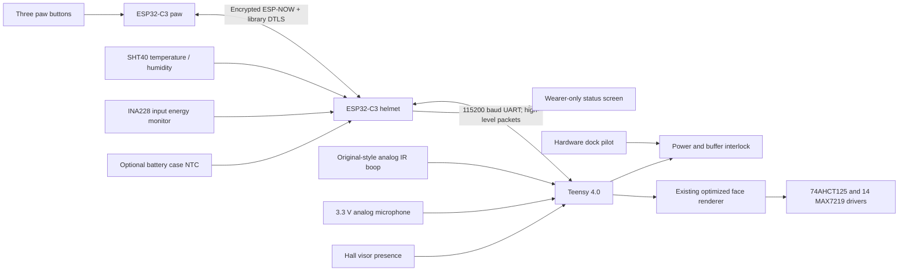
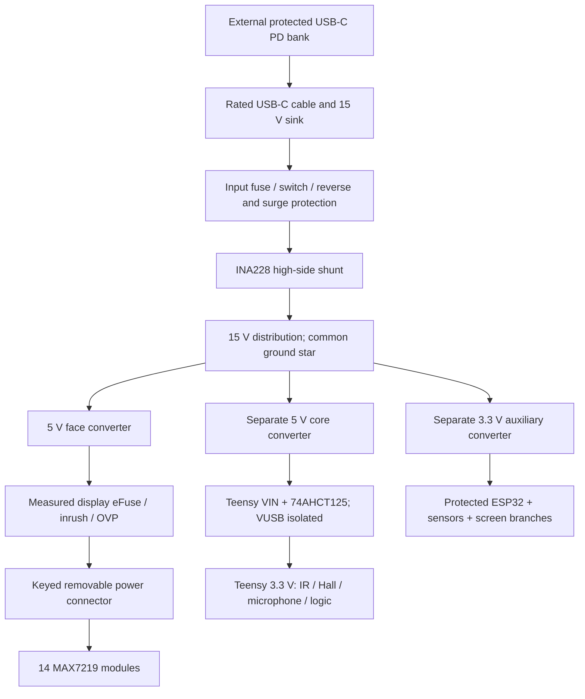

# Protogen Tier 1 / Tier 2 engineering specification — revision 8.2

This preserves the reviewed architecture and incorporates the user's IR-first boop decision and authorization to implement firmware. The software is implemented for bench prototyping. Hardware selections below are candidates with explicit qualification gates, not a purchase order or a released PCB. No hardware was rewired or flashed during this work.

## Architecture and scope

Teensy owns expressions, animation, physical inputs, speech, blinking, sleep and the face. The ESP32 never writes MAX7219 registers. Screen, I2C sensors, RF work and NVS storage run on the ESP32; slow peripherals cannot occupy the Teensy's render loop. There are six selectable faces, with the four originals unchanged. The supplied Teensy firmware has every optional hardware flag commented out, and both ESP32 roles start unpaired with peripheral features disabled.

Tier 1 is qualified power, original IR boop, the two C3 boards, three paw buttons, provisioning, authenticated commands, UART and failure isolation. Tier 2 adds microphone refinement, removable visor/Hall, energy monitoring, internal conditions, optional battery-case temperature and the wearer screen. Cameras, AI processors, camera boops, eye tracking and speculative expansion boards remain outside this build.

## Accepted review corrections

| Review point | Revised requirement |
| --- | --- |
| Hall timing | DRV5032FC nominally samples every 50 ms, but the datasheet allows up to 75 ms. Qualify its digital state for **150 ms**. Repeated reads of its output do not constitute independent magnetic samples. Hall controls logical presence, never immediate electrical disconnection. |
| Display limit | Measure RSET, operating current and inrush before choosing the eFuse limit. Check the **minimum** limit against legitimate load and the **maximum** against wiring, converter and contact limits. No fixed 5 A setting is approved. |
| Paw battery | Measure actual prototype consumption, including reconnects. 1,000 mAh is an upper initial candidate, not a requirement. This implementation keeps RF awake for predictable latency; wake windows/deep sleep are a separate measured optimization. |
| Crypto | Use Espressif's encrypted-peer API and **Mbed TLS DTLS 1.2 PSK**, replacing the earlier custom HMAC/challenge handshake proposal. No custom cipher, key derivation or cryptographic handshake. |
| C3 pins | The maps target **Espressif DevKitM-1** and **Seeed XIAO ESP32-C3** specifically. Changes to either board require a pin and supply review. DevKitM-1 GPIO20/21 belong to its USB-UART bridge, so the Teensy link uses 18/19. |
| Boop | Start with Feronium's original-style IR input and original `vwv`/`vwvL` artwork. Capacitive/piezo is a fallback after optical tests, not the initial sensor package. |

The Hall timing follows the [TI DRV5032 datasheet](https://www.ti.com/lit/ds/symlink/drv5032.pdf). The chip and board maps follow [Espressif's DevKitM-1 documentation](https://documentation.espressif.com/esp-dev-kits/en/latest/esp32c3/esp32-c3-devkitm-1/index.html) and [Seeed's XIAO documentation](https://wiki.seeedstudio.com/XIAO_ESP32C3_Getting_Started/).

## Boop prototype and interaction

The archive uses an analog IR/line-tracking input on A7, a threshold near 500, and the original `vwv` eyes for the reaction. Preserve that approach. A documented inexpensive candidate is [SparkFun's QRE1113 analog breakout ROB-09453](https://www.sparkfun.com/sparkfun-line-sensor-breakout-qre1113-analog.html), powered at **3.3 V**. It is a short-range reflective sensor: its intended line-sensing distance is not proof that it will detect a paw through this visor. If the original module is already available, test that first after identifying its supply, output type, polarity and maximum voltage. A 5 V clone module must not be connected directly to a Teensy input.

Place the emitter and detector at the nose with a dark separator to reduce internal optical crosstalk. Test the actual tinted plastic with its real thickness, curvature and sensor setback. Visible darkness does not establish infrared transmission. Start with USB/live ADC readings and classify bare finger, light/dark fur, thick paw, near misses, head motion, room lighting and sunlight. Adjust the two thresholds from those measurements; retain a release margin rather than using one noisy threshold. A7 gets a 3.3 V pull-up so unplugging a properly wired sensor reads released. ADC1 conversions are asynchronous and bounded; a conversion that never completes latches a fault without waiting inside the face loop.

**Default interaction:** held/proximity (`boop_mode=0`) follows the original intent, ends on release, and caps the reaction at 6 seconds. A continuous held object cannot keep restarting the reaction. The sensor must first report released at boot and after a timeout before another trigger. The boop temporarily owns the original eye artwork and pauses speech/blink overlays; it does not overwrite the selected expression. Release restores that expression.

**Prototype comparison:** `boop_mode=1` gives a timed physical reaction; `boop_duration_ms` is adjustable from 100 to 6,000 ms. Try about 1,000–1,500 ms only if held behavior proves awkward for taps. A paw remote boop is a discrete command and uses a 1,200 ms pulse of the same original artwork. Choosing the physical mode remains a user-facing decision after actual interaction tests.

Initial acceptance target: at least 95 successful intentional interactions out of 100 per tested finger/paw condition, no boot/unplug trigger, no retrigger until release, and zero false activations during a 30-minute head-motion/near-miss/light test. Treat these as bench gates, not reliability claims. If IR fails, first evaluate mounting/window/shielding adjustments that preserve its simplicity. Then compare the fallback:

- AT42QT1011 at 3.3 V, electrode behind the nose, for bare fingers. Test through the actual plastic; tune Cs from the [Microchip datasheet](https://ww1.microchip.com/downloads/en/devicedoc/40001947a.pdf). It may not work through thick paws.
- A nose piezo plus a reference piezo on the helmet frame for paw impacts. Each requires a high-value discharge resistor, series resistance, clamping and a 3.3 V analog front end; never wire a raw piezo directly to Teensy. Compare impact energy/time against the reference, rather than treating all helmet movement as a boop.
- If single taps cannot meet the false-trigger gate, qualify a double tap before producing a single boop event. Start with 80–350 ms between taps. Apply a 750 ms refractory period **after the complete gesture**, not after the first tap.

The fallback analog front end and classification firmware are deliberately deferred until IR has actually failed the tests. Reserving possible pins does not require buying/installing both methods now.

## Wireless architecture and security

| Option | Benefits | Costs for this build |
| --- | --- | --- |
| BLE | Standard secure pairing/connection services, useful if a phone is a primary controller, good low-power options | GATT/service and pairing UI work; bonding/reconnect behavior must still be designed |
| ESP-NOW | Direct C3-to-C3 control without a phone or access point, small datagrams, straightforward dedicated controller | Shared RF channel; callbacks are not application acknowledgements; security/session freshness must be specified |

The implemented v2 design uses **ESP-NOW** with native encrypted unicast and an
independent PSA AES-256-GCM application envelope. Wireless pairing requires
local gestures on both devices, ephemeral P-256 ECDH commit/reveal, comparison
of all six LED authentication digits and second physical confirmations on both.
USB-only provisioning and factory-MAC whitelisting have been retired. See
[the current protocol](WIRELESS_PROTOCOL.md) for the complete authenticated
session/HKDF/replay and rotating identity/rendezvous design.

Teensy Serial1 remains 115200 8N1 with COBS and CRC16, boot epochs, fresh 300 ms
receiver tickets, execution ACKs, deduplication and command rate limits. The
helmet ESP32 validates wireless input before forwarding it. Local rendering and
buttons keep working during wireless loss. Idle RF keepalives are randomized
3–5 s; 100 ms polling supports active gestures and deteriorating links. Radio
loss is detected after 12 s; the existing separate wired heartbeat lets Teensy
clear paw-online within another 2 s. Keyed asymmetric channel recovery on
1/6/11 establishes a fresh authenticated session without needing a message on
the failed channel. Periodic idle renewal changes keys/MACs after 15–17 minutes.

Development remains recoverable with ordinary NVS. Production needs explicitly
provisioned hardware-backed encrypted storage, Secure Boot v2, release flash
encryption, signed firmware, anti-rollback and a qualified update process.
Firmware does not burn eFuses. RF fingerprinting/timing correlation, physical
compromise of development units and broadband jamming remain outside full
protection. See [SECURITY.md](../SECURITY.md),
[production steps](PRODUCTION_PROVISIONING.md) and
[physical release gates](WIRELESS_VALIDATION.md).

## Power architecture

Use a reputable protected USB-C PD bank outside the helmet, on a belt or in a ventilated pocket. The required profile is **15 V / 3 A**. Its cell capacity is in watt-hours, not 20 Ah at 15 V. A 20,000 mAh bank is roughly 72–74 Wh at the cells, with lower usable delivered energy. One candidate family is [UGREEN's 20,000 mAh PD banks](https://uk.ugreen.com/products/ugreen-nexode-power-bank-130w-20000mah), whose published USB-C1 profiles include 15 V / 3 A. Verify the exact regional model and port; do not use other ports during a wear test because renegotiation may interrupt output.

Separate converters prevent a display or auxiliary output short from directly shorting the Teensy's rail. Each branch still needs current protection so its fault cannot drag the shared PD input into shutdown. Common input failure or a ground short is a shared power fault; firmware cannot isolate those. Keep the core path simple and independently protected.

| Load | Planning rail / current | Meaning |
| --- | --- | --- |
| 14 MAX7219 drivers | 5 V; ceiling about 4.48 A LED load plus module overhead | 14 × 8 simultaneously driven segments × 40 mA; all pixels on at maximum duty. Scan duty does not reduce this by another factor of eight. Actual RSET, LED Vf and intensity determine current. |
| Teensy 4.0 | 5 V VIN; budget 0.15 A including small local peripherals | PJRC quotes about 0.10 A at 600 MHz for the board. Reserve margin, not amperes for nonexistent AI hardware. |
| Helmet C3 | 3.3 V; roughly 0.08–0.15 A prototype average, plan 0.40 A peak before auxiliaries | Espressif specifies Wi-Fi TX peaks up to about 335 mA. Actual RF/duty and board losses need measurement. |
| IR / Hall / microphone | Core 3.3 V; initial total budget 0.04 A | IR emitter dominates. Check selected module at 3.3 V. |
| OLED / SHT40 / INA228 | Auxiliary 3.3 V; budget 0.05–0.08 A | Screen content and breakout LEDs matter; sensor averages are much smaller. |
| Auxiliary expansion allowance | 3.3 V branch qualified for approximately 0.7 A | A 1 A converter provides realistic thermal/transient margin for the chosen C3/status hardware. |

The face ceiling is based on [Analog Devices' MAX7219 datasheet](https://www.analog.com/media/en/technical-documentation/data-sheets/MAX7219-MAX7221.pdf); the MCU budgets use [PJRC's Teensy details](https://www.pjrc.com/store/teensy40.html) and [the ESP32-C3 datasheet](https://documentation.espressif.com/esp32-c3_datasheet_en.html). The ceiling is not a measured normal facial load. Measure all-on, actual expressions, brightness settings, startup, detach/reattach and inrush with the real modules.

At a 22.5 W face ceiling plus about 3 W of other outputs, 90% conversion gives approximately 28 W or **1.9 A at 15 V**. Reserve input capability to 3 A for startup, losses and margin. Converter efficiency and enclosed temperature can worsen this estimate. At 4.5 A face load the display path dissipates real heat; make maximum permitted brightness part of hardware qualification.

For runtime, use measured bank-delivered Wh divided by measured average PD-input watts. A bank delivering 60 Wh gives 4 hours at 15 W, or 2.1 hours at 28 W. A 20,000 mAh label does **not** guarantee four hours at full brightness. If the four-hour target fails, first qualify a lower brightness/current setting or a suitably sized external bank, rather than oversizing for hypothetical features.

Candidate parts:

| Function | Prototype candidate | Required check |
| --- | --- | --- |
| 15 V negotiation | Standalone 15 V USB-C PD sink module; reference implementation based on [TPS25730A](https://www.ti.com/product/TPS25730A) | Connector/PCB rated ≥3 A; requested 15 V profile; controlled fallback and correct USB-C CC/ESD design. TPS25730A is a controller, not a buck converter; its bare IC is not a ready-made board. Start with a documented sink module or its EVM, not an undocumented trigger wired blind. |
| Face 5 V | [Pololu D36V50F5 #4091](https://www.pololu.com/product/4091) | Its advertised 5.5 A is thermally dependent. Qualify at **15 V input in the enclosure**; use a higher-current converter only if this measured thermal/load test fails. The previously suggested D24V60F5 is not the current preferred candidate. |
| Core 5 V | [Pololu D24V10F5 #2831](https://www.pololu.com/product/2831) | Separate core branch; input and output capacitance; measured ripple. Disable/shutdown pins must not expose Teensy to the module's VIN pull-up. |
| Auxiliary 3.3 V | [Pololu D24V10F3 #2830](https://www.pololu.com/product/2830) | Feed DevKitM-1 3V3 directly only under the board's single-supply rules. Disconnect the external rail for USB programming unless a qualified power-isolation arrangement is fitted. |
| Display eFuse | [TPS259470A family](https://www.ti.com/product/TPS25947) on an evaluation/custom carrier | Reverse blocking, OVP, inrush and hardware enable. Adjustable limit is 0.5–6 A, part nominal continuous rating 5.5 A, limit tolerance about ±10% above 1 A. Use actual min/max/thermal values, not “5 A exactly.” |
| Auxiliary branch switch | TPS2553 adjustable current-limited switch or equivalent qualified 3.3 V load switch | About 0.6–0.7 A candidate threshold with tolerance checked against peak load and converter protection. Additional small screen/sensor branch isolation if short-circuit isolation within ESP peripherals is required. |
| Input energy monitor | [Adafruit INA228 #5832](https://www.adafruit.com/product/5832), high-side on PD output | Its fitted shunt is **15 mΩ**, not 10 mΩ. Firmware SHUNT_CAL=1875 with 5 A/2^19 current LSB and ADCRANGE=0 matches this board. Recalibrate if a different shunt/board is used. |

Budget input/output fuses from measured normal current, allowed wire/contact current, inrush and the fuse's time-current curve. A 3 A input fuse is an initial class to evaluate, not a value chosen only from the bank's nameplate. Display and core branches get separate fuses; semiconductor current limit is not a substitute for protecting the supply cable. Hardware pilot and eFuse operate independently of Teensy software.

Use a common ground star near the converters. Run a dedicated heavy display return, separate from ADC/microphone ground and the ESP32 return. Start with short 20 AWG display power/return wires and appropriately rated connector crimps; calculate loop drop from actual length and qualified contact resistance. At 4.5 A, a 0.05 Ω loop loses 0.225 V and 1 W. Aim for the farthest module to remain in its qualified voltage window. Do not inject high-current power through thin breadboard rails, Teensy headers or a single low-rated pogo contact. Feed long matrix chains at more than one power point without creating a thin ground-return bottleneck.

Provide 100 nF plus approximately 10 µF close to each MAX7219, as its datasheet recommends, and place measured bulk capacitance near branch loads. Initial candidates are 100–470 µF at face distribution and 100–220 µF plus ceramics at the RF rail. Excess bulk increases inrush and dock residual energy; qualify the ramp/discharge against **total** downstream capacitance. Choose input capacitors/surge suppression and component voltage ratings for plug-in spikes and the maximum allowed PD voltage, rather than a TVS whose clamp exceeds the protected IC's absolute limit.

Protect USB/external supply separation for Teensy exactly as [PJRC describes](https://www.pjrc.com/store/teensy40.html). Treat each ESP board's USB/3V3/external supply similarly: disconnect external power during initial USB flashing, or use a reviewed isolation circuit. The proposed UART isolator is TXU0202 with one supply from each MCU domain, retaining 3.3 V logic and isolating an unpowered side. Direct UART wiring works on a bench with both boards powered, but does not satisfy electrical backfeed isolation by itself.

## Paw power and controls

Use a protected 1S Li-ion/LiPo cell in a padded rigid pocket inside the paw/wrist, not directly beneath a finger pressure point. Include a positive-lead fuse and accessible switch. XIAO's documented onboard charge current is approximately **380 mA**; do not connect a small cell that cannot safely accept that charge current. Its battery pads, plug polarity and protection are board-specific. A 300–500 mAh cell may be enough only after actual consumption and charger compatibility are demonstrated. At 100 mA average, four hours plus 25% margin requires 500 mAh; at 180 mA it requires 900 mAh. These are examples, not measured consumption. A 1,000 mAh cell remains the upper initial candidate.

Start with the onboard charger only if the protected cell's specifications permit its current. Otherwise select a charger with configurable current/temperature input, such as a correctly designed BQ24074 module, and ensure two chargers cannot drive the same cell simultaneously. Do not assume a breakout's TS pin actually senses the pack temperature if it is tied to a fixed resistor. Charge the paw off-body. Battery-case monitoring is supplementary to a protected pack and charger limits.

Next/previous trigger on release; holding both for approximately 1.2 seconds toggles sleep without first changing expression. The third button requests a timed original `vwv` boop. Buttons debounce for 30 ms, must be released after reconnect, and do not queue actions while offline. All three together are reserved for physical provisioning unlock. The first firmware intentionally does not claim low-power sleep performance; measure it, then consider ESP-NOW wake windows and button wake feasibility before shrinking the cell. XIAO GPIO10 is not an RTC deep-sleep wake pin; this map does not promise every button can wake from deep sleep.

## Pin and resource map

### Teensy 4.0

| Pin/resource | Assignment | Status |
| --- | --- | --- |
| 11 / 13 / 8 | MAX7219 DIN / CLK / LOAD through 74AHCT125 | Existing, preserved; hardware SPI at 4 MHz |
| 2 | Existing expression/sleep button to ground | Existing INPUT_PULLUP |
| 5 / 9 / 10 | Existing RGB indicator | Existing PWM; hardware peak current limiting remains required |
| 21 / A7, ADC1 | Original IR analog boop | Existing allocation; now nonblocking polling |
| 14 / A0, ADC0 | Analog microphone | Existing allocation, 4 kHz timer-triggered sampling |
| 3 | Hall sensor active-low/open-drain | Existing optional input, 150 ms logical qualification |
| 0 RX1 / 1 TX1 | Helmet ESP UART | New optional WirelessPaw, 115200 8N1, 3.3 V isolated domains |
| 6 | Dock eFuse power request | New optional VisorConnector; external default-low pull-down |
| 4 | Dock buffer enable request | New optional VisorConnector; active-high request, inverted externally for AHCT /OE |
| 12 | Dock pilot, LOW engaged | New optional input; external pull-up and hardware gate |
| 15 / A1, ADC1 | Switched face-rail voltage sense | New optional nonblocking ADC1; 47k/33k divider |
| 7 / 20 | Unassigned candidate fallback boop inputs | No hardware purchased or firmware connected to them |
| USB | Face Studio/debug/settings | Bounded optional USB work |
| ADC0 / QuadTimer4 submodule 0 | Microphone acquisition | Reserved; do not share with another audio/timer library |
| ADC1 | IR and dock sense | Asynchronous single conversions; approximately 5 ms service cadence |

UART, SPI, GPIO, two ADCs, PWM and the timer coexist. GPIO22/23 remain unused; there is no speculative sensor hub. New pin definitions live only behind optional feature flags; the existing working allocations were not moved.

### Helmet ESP32-C3 DevKitM-1

| Pin | Assignment |
| --- | --- |
| GPIO18 / 19 | UART1 RX from Teensy TX1 / TX to Teensy RX1; native USB unused on this board |
| GPIO20 / 21 | Board USB-to-UART console; do not connect to the Teensy link |
| GPIO0 / 1 | I2C SDA / SCL; pull-ups to auxiliary 3.3 V |
| GPIO4 / 6 / 7 | OLED SPI SCK / MOSI / CS |
| GPIO5 / 10 | OLED DC / RESET |
| GPIO3, ADC1 channel 3 | Optional battery-case NTC |
| GPIO9 | Existing BOOT button, provisioning unlock after boot; a strapping pin at reset |
| GPIO2 / 8 | Unassigned; strapping/onboard connections require caution |

### Paw Seeed XIAO ESP32-C3

| Board pad / GPIO | Assignment |
| --- | --- |
| D2 / GPIO4 | Next button to ground |
| D3 / GPIO5 | Previous button to ground |
| D10 / GPIO10 | Boop button to ground |
| D1 / GPIO3 | Optional cell-voltage divider, enabled only when fitted |
| GPIO18 / 19 | Native USB Serial/JTAG console and programming |
| GPIO2 / 8 / 9 | Boot strapping pins, no controller buttons added |

The GPIO numbers in `DeviceConfig.h` are exact for these boards. On a different C3 board, exposed labels and onboard connections must be checked before using this firmware.

## Hall sensor and removable assembly

DRV5032FC is omnipolar, open-drain and suitable at 3.3 V. Mount it on the stationary helmet frame; mount the magnet on the removable assembly. Use an external 10 kΩ pull-up to core 3.3 V, 100 nF at the sensor, and a small input RC (e.g. 1 kΩ / 10 nF) for wiring noise. Qualify magnet orientation, distance, movement tolerance, hysteresis and fields from the retention magnets. LOW means visor present; an unplugged lead reads HIGH and logically blanks the display. The 150 ms software filter allows the sampled sensor's worst-case timing. Teensy updates visibility and pauses face/speech when absent; reappearance composes the entire current face before leaving MAX7219 shutdown.

The prototype's straightforward removable power connection is an **AMASS XT30-class keyed power connector**, with a locking JST-GH signal harness. This avoids assigning several amperes to an undocumented magnetic header. Switch off/unplug upstream power before servicing it. The magnetic implementation remains an alternative to qualify, not a reason to delay the first IR/paw prototype.

For a magnetic/pogo assembly, use an asymmetric mechanically keyed, recessed contact layout and a separate first-break/last-make pilot. Design in the full display current, not only normal low-brightness current. A 14-position starting topology uses four +5 V contacts, four ground contacts, three SPI signals, one protected 3.3 V sensor supply, one IR analog return, and one pilot. Select contacts from a manufacturer with per-contact ratings, resistance, plating and cycle data. Parallel contacts do not multiply the rating perfectly: equalize paths, derate, examine partial engagement and one failed contact, and measure the hottest contact under full load. If that cannot be qualified, retain XT30 power rather than claiming safety from contact count.

The pilot immediately hardware-disables the eFuse and AHCT outputs. Firmware requests do not bypass it. Attachment waits for contact settling, ramps power, confirms measured 4.65–5.35 V, reloads MAX7219 scan/current/test/shutdown settings, uploads the **complete** current framebuffer, then shows it. Software checks complement the hardware gate; Hall is too slow for this function.

Disconnect qualification must measure mechanical pilot lead time, gate response, stored charge, rail discharge, accidental polarity/alignment, bounce and power from signals. A load switch going off does not remove energy already stored on module capacitors. Discharge belongs on the removable side if capacitors can separate from the stationary discharge path. Choose its resistor/MOSFET from measured capacitance and allowable touch/contact energy; do not invent a safe discharge time from Hall debounce. These are release gates for hot-plug operation. The supplied dock firmware cannot establish connector safety on its own.

## Microphone and speaking behavior

Retain a 3.3 V MAX4466 electret amplifier candidate with adjustable gain. Mount it close to the wearer's mouth, mechanically isolated from shell taps, away from fans and outside direct breath moisture. Use a foam windshield and short signal/ground pair or shielded cable. Keep its ground and wire route away from matrix power pulses, PD leads, converter inductors and RF antennas. Power it through a quiet filtered core 3.3 V branch with local decoupling; validate that filtering does not reduce headroom. Apply a midrail bias/fault-safe input when a connector is unplugged. No analog signal may exceed 0–3.3 V.

ADC0 remains hardware-triggered at 4 kHz with a fixed ring, bounded DSP, adaptive floor, adjustable threshold, attack/release, calibration and spectrum/amplitude mouth modes. Boop/visor/sleep take priority; speech uses the mouth while blink uses eye masking, so ordinary rendering stays intact. A flat rail for roughly 64 ms or missing conversion progress for 100 ms disables speech and latches a microphone fault. `MIC 1` or the Face Studio enable control retries it; repeated faults need wiring/gain diagnosis. The normal face continues.

This is sound-driven speech activity, not guaranteed speaker identification. Nearby loud music/people can still cross the gate. Test quiet voice, shouting, con noise, fan hum, taps and clipping. Prefer close placement and gain/threshold calibration over aggressive algorithms that miss speech. Record false-mouth activity and ADC drops with LEDs at the qualified worst load. A true near-field/noise-rejecting microphone or band-limited VAD is a later refinement only if these measurements justify it.

## Temperature, energy and wearer screen

- **Environment:** Adafruit SHT40 #4885 at 3.3 V, I2C 0x44. Mount around temple/upper cheek in head-space airflow, away from regulator heat, skin contact, direct exhalation and intake air that bypasses the wearer. Do not cover its sensing opening with conformal coating. CRC failures, implausible readings and stale data show invalid status. Heater is off during ordinary measurement so it does not distort the displayed conditions. [Sensor specifications](https://www.adafruit.com/product/4885).
- **Battery case temperature:** Optional 10 kΩ B3950 NTC taped to the outside of the protected bank case, with electrical insulation and strain relief. Use a 15 kΩ upper divider, 10 kΩ NTC to ground, filtered/calibrated ESP ADC. It observes case temperature, not cell-core temperature or SOC. Do not open a commercial pack. An NTC lead must not turn a distant battery into an unprotected source inside the helmet.
- **Energy:** INA228 ahead of the converters measures delivered input energy, including their losses. Its hardware accumulator is read, validated and accumulated into mWh; occasional NVS checkpoints avoid per-frame flash writes. Calibrate usable delivered mWh from a fully charged bank under representative load. `FULL` is a physically unlocked owner command used only after actually charging/replacing the bank. The percentage is shown with `~`; after a reset, monitor fault or unmeasured gap it becomes unknown until a valid full reference. This conservative behavior avoids fabricating SOC from regulated 15 V. Charge/power the system while monitoring only under a separately reviewed power-path design.
- **Screen:** Adafruit 1.3-inch SSD1306 #938, SPI mode, auxiliary 3.3 V logic/supply qualified for the module. ESP32 owns it, avoiding a second SPI/I2C load on Teensy. It shows estimated battery, head temperature/RH, expression, face link, paw connection, microphone and faults. SSD1306 is required for this driver; a visually similar SH1106 module needs another driver. [Module documentation](https://www.adafruit.com/product/938).

Fit and focus are unresolved: a bare OLED centimeters from the eye may be unreadable. Mock up its distance and eyeline first, then select a position/optical magnifier if required. Do not place it in the main viewing aperture or assume 1.3 inches is readable merely because it fits. Start dim, at a glance position near the lower side. The display driver updates at 5 Hz on a separate low-priority task; its own SPI transfer cannot stall the Teensy. A SPI panel with no readback cannot positively detect an unplugged screen; software can report bus/init errors but cannot prove the panel is visible.

Warning thresholds are initial comfort indicators: battery ≤20% / ≤10%; helmet ≥35°C / ≥40°C; battery case ≥45°C / ≥50°C; lost paw/face link; invalid sensors. Qualify warning visibility and threshold behavior under real airflow. Battery manufacturer's operating/charging limits take priority. These readings are not a medical heat-risk instrument. Warnings stay on the wearer screen and do not replace the outward expression. Hardware battery protection handles electrical cutoff independently of these advisory readings.

## Physical layout

| Item | Placement and routing |
| --- | --- |
| Bank | Belt/pocket, protected enclosure, accessible main power disconnect, strain relief at neck/helmet entry; avoid concentrating weight in the helmet |
| PD/converters/eFuse/INA | Rear/lower side electronics bay with airflow and nonconductive barrier to skin/foam; keep hot parts off head padding and away from humidity sensor |
| Teensy | Stationary service bay with easy USB/program-button access and short buffered SPI path to the face |
| Helmet ESP32 | Side/rear service bay; antenna clear of grounded copper, metal magnets, dense wire bundles and the wearer's head; verify RF before fixing location |
| IR | Nose, close to actual optical surface, emitter/detector shielding; separate small harness from high-current display wires |
| Microphone | Close to mouth with windshield and moisture protection; quiet analog routing, away from fan/inductor/power return |
| Hall/pilot | Hall at keyed visor attachment; pilot integrated with connector mechanics, retention magnet fields tested separately |
| SHT40 | Head-space temple/cheek airflow; physically remote from the electronics hot spot |
| OLED | Wearer glance location after focus/comfort mockup; removable bracket and flexible strain-relieved cable |
| Paw electronics | Wrist/paw pocket with padded rigid battery protection, accessible switch and USB; button wiring secured against flex and fur pressure |

Label connectors, use keyed plugs and service loops, retain conductors mechanically, and cover exposed power contacts. Keep the electronics detachable without pulling glued sensor leads. Avoid a cable route that blocks airflow or presses hard parts into the face. Nothing is mounted or permanently wired by this software change.

## Failure behavior and qualification order

| Failure | Expected behavior / boundary |
| --- | --- |
| Paw off, RF jam, helmet ESP crash | Current face/local controls continue; pending commands dropped, paw status times out |
| Malformed RF/UART or stale command | Bounded rejection; no expression change from it |
| IR absent / ADC1 failure | Unplugged IR reads released and face continues. ADC1 failure leaves the loop/local controls responsive; an enabled protected dock blanks because its voltage can no longer be qualified. |
| Microphone flat rail or acquisition stops | Speech disabled/fault; original expression/blink continue |
| I2C CRC/timeout/garbage | Invalid wearer readings, bounded timeout and 5 s retry; no face effect |
| Screen software failure | Local status task may fail; independent Teensy face continues |
| Hall unplugged or visor absent | Intentional safe display blank; Teensy runs and restores on qualified return |
| Pilot open / bad face rail | Hardware cutoff plus software blank; complete initialization on safe reattach |
| Auxiliary/display rail short | Branch protection must hold core/input within limits; prove on current-limited bench |
| Main bank/cable/input power loss | Entire system loses supply; not a software-isolatable fault |

1. Inspect all RSET resistors, decoupling, module voltage/current and full chain. Establish permitted brightness/current and far-end rail drop on a current-limited bench.
2. Qualify PD bank/sink/cable, each converter, protection thresholds/tolerances, inrush and thermal steady state. Start with fixed wired connectors.
3. Test IR alone through the actual visor. Compare held/timed behavior using original artwork; only then authorize fallback hardware if needed.
4. Flash/provision the C3 pair on the bench, attach the optional isolated UART, and test ACKs, stale inputs, pairing rejection, reboots, interference and button release/reconnect. Measure paw energy before deciding cell capacity.
5. Test microphone gain/noise/clipping and genuine input cadence during heavy display load. Adjust thresholds and retry faults through Face Studio.
6. Add Hall/dock only after electrical/mechanical qualification; test complete framebuffer restore and partial engagement on a jig before wearing it.
7. Fit environment/energy/OLED, calibrate delivered bank energy, demonstrate unknown/low-battery and all warnings, then run a representative ≥4-hour endurance/comfort test.

See [HARDWARE_WIRING.md](HARDWARE_WIRING.md) for the schematic connections, [WIRELESS_PROTOCOL.md](WIRELESS_PROTOCOL.md) for packet details and [firmware/esp32/README.md](../firmware/esp32/README.md) for builds/provisioning. The completed software checks and all changed behavior are summarized in [IMPLEMENTATION_8_2.md](IMPLEMENTATION_8_2.md).
