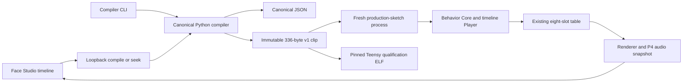

# P6 Declarative timelines

Starting point is the clean [P5 merge](https://github.com/Fur-Byte/Protogen/commit/4f1b56254029385ef77080987023aab874f1aa42).
The detached reference reproduced all legacy and seeded V2 traces. This
phase adds no transport command, EEPROM migration, ISR, task, clock change,
DSP change, or hardware activation.



## Schema and asset ownership

See [three-channel.json](../tools/helmet/timelines/three-channel.json) for a
complete document. The clip declares version 1, lowercase ASCII ID, printable
name, duration (1–60,000 ms), initial expression, blink/idle settings, cosmetic
seed and modeled audio. Events declare absolute start in ms, duration up to
5,000 ms, region, property, endpoints, easing and priority. Both clip
completion and cancellation use `release`. Optional repetition expands
2–8 copies with a positive interval. The compiler accepts at most 32 source
events and 32 expanded events. Equal-time expanded events use source base
time followed by declaration order. Canonically sorting the source by its base
time keeps this order stable on re-import. Endpoint overlap is inclusive,
as in P5. More than eight overlapping events fail validation.

The Python compiler is shared by preview, export, CLI and CI. It rejects
duplicate keys, unknown fields, booleans masquerading as integers, floating
point numbers, invalid Unicode, invalid lengths and capacities, unsafe IDs,
invalid enum/region combinations and excessive nesting. The generated
header contains only decimal bytes under a fixed C++ identifier. Names and
IDs never enter the generated C++ tokens.

Version 1 has a 16-byte explicit little-endian prefix and 32 fixed
10-byte event records. Unused records and reserved bytes are zero.
The prefix carries version, event count, clip duration and declared initial
inputs. The clip occupies 336 bytes as a read-only uint8_t array, with no
native struct padding or alignment dependence. C++ checks the bounds
independently, including in a static assertion on generated assets.
The compiler and runtime share the existing P5 region/motion/easing ordinal
contract, checked by 4,000 independent signed rounding/curve comparisons.

## Runtime

The flag `PROTOGEN_ANIMATION_TIMELINES` defaults to 0, accepts 0 or 1, and
requires `PROTOGEN_ANIMATION_V2=1`. P5 region-wide arbitration stays in the
feature-off branch. Feature-on uses at most nine scans of eight slots per
pose, covering four independent channels on each eye plus mouth. Lid and
squint share a closure channel. Full Face applies only that event's channel
to the regions it can affect. Priority, admission order, slot tie-breaks and
generation reuse are inherited from P5. The existing renderer selects the
sprite, applies source-row closure, displaces in signed coordinates and
clips. The Wink guard and immutable audio snapshot remain in that renderer.

The core has one player and the original eight-slot table. The player
keeps one generation handle per slot and releases only tracks it admitted.
A new valid start replaces the old clip; invalid input leaves it running.
Each loop handles at most eight due events, so a legal same-time group fits one service opportunity. Late events whose inclusive
window has ended are recorded as skipped, and an admitted late event retains
its absolute start instead of restarting its curve. Shared-table conflicts
report Full without eviction. An ended clip releases all owned tracks
immediately and can drain pending skip accounting over later loops.
Version 1 only runs one clip at a time. Progress has a bounded per-event
outcome array. There are no heap allocations in the portable runtime.

Playback services events before the sketch's existing boop expiry and
render eligibility. Blanking and safety precede composition. Boop masks
the full face, blink and causal transitions mask experimental eye
channels, and active speech or glitch retains mouth ownership. The
recorder/cache build uses the same paths. P5 causal source poses and
real display observations stay authoritative.

## Studio and compilation

```sh
python3 scripts/helmet-tool.py
python3 scripts/timelines/compiler.py tools/helmet/timelines/three-channel.json > TimelineAsset.h
python3 scripts/check-timelines.py --deep
python3 scripts/check-timeline-build.py --document tools/helmet/timelines/three-channel.json
```

Open Face Studio on the printed loopback address. The timeline panel
supports a ruler and scrubber, grouped region/property tracks, keyframe
creation/removal, editable endpoints, easing, priority, repetition,
validation, JSON import/export and C++ export. Space plays/pauses, arrows
step by 16 ms, Home restarts when the timeline region has keyboard focus.
The scrubber retains its native keyboard controls. The canvas uses actual
firmware frames. Editing, validation, and asset export have distinct
status labels.

Every seek starts a fresh process and seeds configuration, acquisition,
render/cache, recorder, and cosmetic state from the same asset. The runner
advances through the requested millisecond's complete service opportunity.
A batch obtains up to 16 frames from one uninterrupted replay. There is at
most one running seek per local backend and one outstanding scrub request
per editor. A revision and request sequence reject stale responses. Warm
host seeks include process launch and are measured in the report.
A batch's progress summary is for its latest requested time.

The initial state fields are desktop simulation conditions. The board build
does not write configuration or synthesize sensor input from asset bytes.
The qualification linker explicitly retains both the read-only asset and
`protogenStartLinkedTimeline(now)`. Nothing calls this function on physical
hardware. A board integrator would call it explicitly in the owner context
after establishing the expected live conditions. No USB upload or activation
command exists. The ELF check searches for one byte-exact compiled asset.
The [browser walkthrough](validation/P6_BROWSER_WALKTHROUGH.md) records
creation, inspector edits, backward seeking and import/export through the UI.
The exact browser-authored JSON and generated header were exported from
Face Studio, independently recompiled by the CLI, linked into Teensy, and
replayed by the actual firmware twin.

The HTTP interface requires loopback Host/Origin, a simulator transport,
fixed-length JSON up to 32 KiB and a bounded read. It cannot supply asset
paths. Imported file text passes through the same duplicate-key parser.
The live USB controls have the same commands as P5 and receive no timeline
requests. Local authorization remains scoped to the existing private
loopback service.

## Verification and outstanding work

Fast CI exercises C++ asset validation, curves, malformed source, timeline
capacity and order, linked asset bytes, HTTP round-trip and independent
three-channel pixels. The full workflow adds randomized seeks, optical
output checks in the modeled canvas, rollover, boop/visibility and audio,
and a 60-second upper-bound replay. It keeps the existing P0–P5 workflows.
Output evidence is under `build/p6-evidence`.

Physical stack high-water, real service latency, power, actual display
readability and thermal behavior remain unqualified. Host seek latency
includes modeled ADC, serial, and frame servicing plus process startup
and trace capture. P6 adds no physical playback command and has no P7
dependency.
