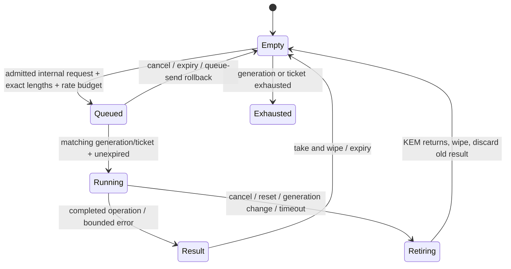

# ML-KEM-1024 crypto-worker qualification

> **Target plan (2026-10-06):** ESP32-S31 is the intended final wireless MCU
> for helmet and Paw; C3/v3 is retained as legacy development/regression.
> Current production sources remain v3. Public S31 preview builds and a 48 KiB
> ML-KEM-1024 worker have static resource evidence, but the supported-stable SDK
> and its memory-protection implementation block the production migration/v4
> phase. Physical S31 qualification is separately pending. See the
> [S31 preflight](WIRELESS_S31_PREFLIGHT.md) for evidence and remaining work.

Date: 2026-10-06. Production baseline:
`c26464d5529b78d8e03ddafd9830d99ecee7d2d5`.
Continuation of [the v4 preflight](WIRELESS_V4_PREFLIGHT.md).

**ML-KEM-1024 NOT SAFE TO INTEGRATE — qualification is incomplete.**
The static evidence supports evaluating a dedicated **32,768-byte** worker on
ESP32-C3. It does not establish MCU stack high-water, post-Wi-Fi free heap,
fragmentation, operation duration, idle-watchdog health, or radio/UART latency.
Those are required approval gates. There is no measured whole-controller
impossibility finding, and there is no approval to integrate either backend.

The 24,576-byte default-stack candidate is rejected. Decapsulation's known
compiler frames total 24,496 bytes, leaving only 80 bytes before the worker and
platform context. KeyGen with pairwise consistency testing (PCT) has a known
26,320-byte path, exceeding that allocation by 1,744 bytes.

Production v3, its task configuration, pairing/storage schema and wireless
architecture are unchanged. No v4 protocol, downgrade path, alternative parameter
set, firmware upload or hardware change was introduced. The qualification probes
are uncalled and exist only in separate ignored ELF files.

## Evidence and reproduction

Machine-readable evidence: [pq-worker-qualification.json](validation/pq-worker-qualification.json).
Pinned inputs: [native pins](../scripts/tests/mlkem-preflight-pins.json) and
[wolfCrypt pins](../scripts/tests/pq-worker-pins.json).

```sh
python scripts/build-esp32.py                 # build only, never upload
python scripts/check-mlkem-preflight.py       # original 145-vector preflight
python scripts/check-pq-worker.py            # isolated worker qualification
bash scripts/test-wireless.sh                # unchanged full v3 regression
```

The worker script requires the existing pinned PlatformIO/ESP-IDF toolchain,
Linux host compiler/pthreads/getrandom, verified native sources/vector fixtures,
and Clang Static Analyzer. `MLKEM_CLANG` selects Clang when it is not on PATH.
Outputs are under ignored `build/pq-worker/`. It verifies source/archive pins,
uses warnings as errors, rejects unbounded GCC frames, and checks that its own
inputs did not change during the run. Sanitizers instrument the entire evaluated
backend, not just the wrapper. Non-PIE test executables avoid host ASan mapping
conflicts. Deterministic fixtures are public test material, never firmware entropy.

The isolated relinks reuse the already compiled v3 application and actual IDF
archives. PlatformIO's direct application objects replace CMake's absent dummy
object/application archive. Additional probe/backend objects are retained with
explicit linker roots. This is a compile/link RAM reservation experiment, **not**
a running worker, a changed production application, or an uploadable release.

## Largest frame and call chain

Backend: portable C mlkem-native **v2.0.0**, commit
`d1b2fe782888bdb761a50336012923180be7f502`, MIT license choice from
`Apache-2.0 OR ISC OR MIT`. Source archive SHA-256:
`7c7a10464ba3c62d5657a70da495539ab7f28e464cff80eb9d8173e2bc91c4d3`.
Neither arithmetic nor FIPS202 native assembly is enabled. PCT is explicitly
enabled for this worker evaluation; original no-PCT numbers remain historical.
No cryptographic internals were edited.

The largest individual RV32 `-Og` frame is **19,056 bytes**, owned by
`pqqual_indcpa_enc` (the configured namespace of upstream `mlk_indcpa_enc`),
`mlkem/src/indcpa.c`. It is used both by Encaps and by Decaps's re-encryption check.
Its declared aligned workspace is:

| Workspace | Bytes | Secret classification |
| --- | ---: | --- |
| `at`, 4×4 polynomial matrix | 8,192 | Derived from public encapsulation-key seed |
| `sp`, `pkpv`, `ep`, `b`, four polynomial vectors | 8,192 | `pkpv` public; the others contain secret noise/intermediates |
| `v`, `k`, `epp`, three polynomials | 1,536 | Secret message/noise/intermediates |
| `sp_cache` | 1,024 | Secret-dependent cached polynomial products |
| `seed` | 32 | Public seed |
| **Declared total** | **18,976** | Remaining 80 bytes are compiler/alignment overhead |

Key generation's 15,536-byte inner frame is dominated by its 8,192-byte matrix,
three 2,048-byte vectors and a 1,024-byte multiplication cache, plus seed/hash
buffers. The decapsulation wrapper has a 1,792-byte frame and calls encryption
while retaining its own temporary message, coins and ciphertext workspace.

| ML-KEM-1024 operation | Known nested RV32 frame sum | 24 KiB headroom | 32 KiB headroom |
| --- | ---: | ---: | ---: |
| KeyGen, PCT enabled | 26,320 | −1,744 | 6,448 |
| Encaps | 22,992 | 1,584 | 9,776 |
| Decaps | 24,496 | 80 | 8,272 |

These are conservative sums of GCC call-graph frame estimates, **not measured
stack high-water or a complete certified bound**. Unknown ROM/libc/RNG/scheduler
frames and interrupt context must still be considered. The worker loop adds an
80-byte frame and the operation adapter adds a small frame. Separate C3 ISR stack
storage is already included in linked static RAM; interrupts also save task
context. Tail calls/compiler changes can affect the sum. Detailed paths are in
the JSON. The deepest KeyGen path is KeyGen → PCT → Decaps → encryption → matrix
sampling → four-way rejection sampling → SHAKE → Keccak.

The configured main stack stays **12,288 bytes**. Inspection of IDF 6.1's
`ESP_TASK_MAIN_STACK` macro finds an additional 512 bytes with this configuration,
so the actual IDF creation argument is **12,800 bytes**. This distinction corrects
an omitted SDK overhead in the earlier preflight; either size is inadequate for
direct main-task ML-KEM. No stack setting was increased.

## Supported workspace option

Upstream documents `MLK_CONFIG_CUSTOM_ALLOC_FREE` together with
`MLK_CONFIG_CONTEXT_PARAMETER` and `MLK_CONFIG_CONTEXT_PARAMETER_TYPE`. It labels
custom allocation **experimental**, with a potentially changing API. There is
no nonexperimental caller-workspace API or switch that simply makes the default
stack allocation small. Its optional custom zeroize hook does not itself move
workspaces. The tested hooks are in [arena_config.h](../scripts/tests/pq-worker/arena_config.h).

The experiment uses a per-context 24,576-byte, 32-byte-aligned fixed arena and
64 bounded LIFO bookkeeping entries. Allocation sizes come from upstream
compile-time types/counts. It never uses malloc or radio-provided lengths. Every
free verifies upstream zeroization in this **test-only** allocator; the whole
arena is also wiped at operation completion, including failures. Internals remain
unchanged.

| Operation | Measured host arena peak, deterministic API | Known residual RV32 stack path |
| --- | ---: | ---: |
| KeyGen with PCT | 22,336 | 3,904 |
| Encaps | 19,104 | 3,808 |
| Decaps | 20,704 | 3,776 |

The randomized KeyGen API needs another 64-byte allocation; upstream advertises
22,400 bytes for PCT KeyGen. Its Encaps bound is 19,136 and Decaps bound 20,704.
An **8 KiB residual worker stack + 24 KiB arena** would still cost about 32 KiB
before slot/bookkeeping overhead. It is not a free RAM reduction. All **77**
allocation-failure positions exercised by the three operations failed safely,
freed in reverse order, and wiped allocations. This option is separately tested,
not selected for production. Experimental API assurance and allocator review are
additional gates.

## RAM budget for both roles

ESP32-C3 physical SRAM is 409,600 bytes. Excluding the 16 KiB cache leaves
393,216 bytes of D/IRAM address space. The linker's application D/IRAM region is
321,296 bytes; IRAM code and DRAM share physical memory and must not be counted
twice. IDF additionally releases a **71,920-byte** startup-reserved region before
`app_main`; optional RTC heap contributes at most 8,168 bytes here. Allocator
metadata, alignment and runtime allocations reduce those theoretical capacities.

| Role / separate ELF | `.data` | `.bss` | Static RAM total | Application-region tail before runtime allocations |
| --- | ---: | ---: | ---: | ---: |
| Helmet v3 baseline | 14,044 | 20,872 | 34,916 | 198,816 |
| Helmet + 24 KiB probe | 20,468 | 45,872 | 66,340 | 167,392 |
| Helmet + 32 KiB probe | 20,468 | 54,064 | 74,532 | 159,200 |
| Paw v3 baseline | 13,660 | 19,336 | 32,996 | 215,072 |
| Paw + 24 KiB probe | 20,060 | 44,320 | 64,380 | 183,696 |
| Paw + 32 KiB probe | 20,060 | 52,512 | 72,572 | 175,504 |

Baseline IRAM alias reservations are 87,552 bytes helmet / 73,216 bytes paw and
are unchanged by these probes. The 32 KiB worker adds **39,616 / 39,576 bytes**
of static RAM. Its input/result slot is 6,336 bytes: public key 1,568, private key
3,168, ciphertext 1,568, shared secret 32. Remaining overhead includes worker
metadata, static queue/mutex/TCB, measurement counters and link alignment.
The slot's nonzero-initialized owner is placed in `.data` by this compiler.
Static stack and slot are reserved at boot, not deducted again when the task is
created. Creating the task can still have IDF/libc/TLS bookkeeping effects that
have not been measured.

Adding startup and optional RTC regions gives theoretical gross capacities of
**239,288 / 255,592 bytes** after the 32 KiB probe's static reservations. These
are not free-heap readings, largest-block readings, or comfortable-margin proof.
All normal v3 wireless objects are included in the baseline; RV32 `wirelessLink`
is 2,664 bytes. Future v4 candidate storage, additional caller-owned result copies,
PQ reassembly and P-256/PSA heap peaks are **not** included. At least another
6,336-byte caller slot and bounded reassembly need an explicit integration budget;
slot ownership transfer may reduce copies only after review.

| Required runtime observation | Helmet | Paw |
| --- | --- | --- |
| Heap before task creation, after normal wireless initialization | **Not measured** | **Not measured** |
| Heap after task creation | **Not measured** | **Not measured** |
| Minimum free heap during KeyGen / Encaps / Decaps | **Not measured** | **Not measured** |
| Largest free internal heap block under sustained load | **Not measured** | **Not measured** |
| Crypto-task stack high-water / remaining margin | **Not measured** | **Not measured** |
| RAM remaining with all runtime driver/PSA objects active | **Not measured** | **Not measured** |

The probe contains numeric-only `heap_caps_get_free_size`, local minimum heap
monitoring, largest-block and `uxTaskGetStackHighWaterMark` measurements. On this
IDF port the latter and `xTaskCreateStatic` depth use **bytes**, not words. The
probe has never run on a board. Local heap-minimum monitoring is global to IDF;
serialize hardware experiments and record concurrent driver allocations too.

Important existing stack reservations are unchanged:

| Task | Configured / creation bytes | Qualification note |
| --- | ---: | --- |
| Main | 12,288 / 12,800 | Priority 1 |
| Wearer I/O | 6,144 | Priority 1, both roles |
| ESP timer | 3,584 / 4,096 | SDK extra 512 |
| Event loop | 2,304 / 2,816 | SDK extra 512; TCP/IP core locking disabled |
| Idle | 1,536 | Watched by task watchdog |
| FreeRTOS timer daemon | 2,048 | Enabled |
| TCP/IP | 3,072 / 3,584 | Configured; actual instantiation must be observed |
| IPC | 1,024 | Configured; unicore instantiation must be observed |
| ISR | 1,536 | Already in static `.bss` |

Wi-Fi's internal task stack/control objects require runtime observation; closed
vendor implementation prevents a complete compiler budget. Configured buffers
are 10 static RX, up to 32 dynamic RX and 32 dynamic TX. Their allocation peaks,
metadata, PSA state, UART ring and normal service workload must be measured.
No host RSS is used as an ESP32 RAM figure.

## Backend comparison

| Property | mlkem-native portable C | wolfCrypt portable C, small memory |
| --- | --- | --- |
| Upstream | [PQ Code Package](https://github.com/pq-code-package/mlkem-native) | [wolfSSL](https://github.com/wolfSSL/wolfssl) |
| Pin | v2.0.0, `d1b2fe782888bdb761a50336012923180be7f502` | v5.9.4-stable, `3c5eead44904df64e6a5a1f4ebdce377d35a849a` |
| License | MIT chosen | GPL-3.0-or-later or commercial; production compatibility unresolved |
| Final FIPS 203 / ML-KEM-1024 | Yes; PCT explicitly enabled | Yes; PCT explicitly enabled |
| Old Kyber | Not used | `WOLFSSL_MLKEM_KYBER` explicitly absent |
| Largest RV32 frame | 19,056 | 6,192, `mlkemkey_encapsulate` |
| Known KeyGen / Encaps / Decaps stack paths | 26,320 / 22,992 / 24,496 | 12,992 / 7,600 / 9,200, including measurement shim |
| Object text, unlinked / all exported routines | 15,512 | 26,948 backend bytes, plus 468 shim bytes |
| Backend context / workspace | Default stack; no internal heap | 5,024-byte RV32 key context; no internal heap |
| ESP32-C3 compatibility | Portable RV32 `-Og` compile/link passes | Portable RV32 `-Og` compile passes; no firmware integration |
| Security design | Constant-time secret operations and implicit rejection; upstream formal memory/type-safety work | Constant-time comparison/masked rejection and optimizer barriers in portable code; secure `ForceZero` paths |
| Maintenance | Active PQ Code Package project | Active maintained wolfSSL release; embedded/ESP-IDF support exists |

wolfCrypt configuration is recorded verbatim in
[wolf_settings.h](../scripts/tests/pq-worker/wolf_settings.h): final ML-KEM-1024
only, `WOLFSSL_NO_MALLOC`, `WOLFSSL_MLKEM_MAKEKEY_SMALL_MEM`,
`WOLFSSL_MLKEM_ENCAPSULATE_SMALL_MEM`, `WOLFSSL_VALIDATE_MLKEM_KEYGEN`, portable
SHA3/SHAKE, no assembly, no cached matrix, no dynamic keys. Host deterministic
APIs use externally supplied public fixture coins; `WC_NO_RNG`/`WC_NO_HASHDRBG`
is **measurement-only**, not a recommendation to disable production entropy.
Both backends need secure production randomness and entropy-lifecycle review.

Wolf archive SHA-256:
`20fceb75ecac0fdb241f6d683e8cd1b579db0297f6d506d13eca9656262d72a5`.
The verified archive, primary source hashes and exact configuration make the
experiment reproducible. No wolfSSL source or binary is committed into production.
Its smaller stack is useful evidence, not sufficient reason to replace the native
candidate. It needs licensing, assurance, full API validation and MCU qualification.
Source-level constant-time design is not a target-side timing/power/EM guarantee.
PQClean was excluded as the maintained alternative because its upstream now
announces retirement. liboqs using the same mlkem-native code is not independent
backend evidence.

## Bounded worker architecture and cancellation

The candidate uses one permanent statically allocated task, 32 KiB stack, static
TCB, static mutex, a **one-token queue**, and **one 6,336-byte in-place slot**.
Queued, running and unclaimed-result states all occupy the same slot. It performs
only KeyGen/Encaps/Decaps; it has no command dispatcher or radio callbacks.
The normal ONLINE caller uses its existing stack and never runs KEM inline.
The permanent worker stack remains reserved while idle; it is not free RAM then.



Structural/authentication/rate limits must execute in the existing wireless
state machine **before** submitting expensive work. During first physical pairing,
permission must instead come from the bounded local pairing window/source lock.
The prototype's `admitted` flag models that decision; it neither implements
v4 authentication nor proves future radio admission. No raw radio ingress calls
it. Requests accept three internal enum values and exact standardized lengths;
no pointers/lengths are retained from callers after the fixed input copy.
The queue carries only a generation/ticket, never arbitrary pointers or sizes.

Each operation has capacity-one, one-second refill admission in the model;
one operation total may execute at a time. Cancellation does not reset budgets.
PCT suboperations are part of the bounded KeyGen cost, not extra queued requests.
The five-second request/result deadline is a model limit, **not evidence** that
an MCU KEM completes within five seconds. A measured maximum must justify a
shorter production deadline and rate settings; no punitive lockout is introduced.

The port serializes metadata/copies with a mutex and executes KEM outside it.
It never disables interrupts over KEM, inserts yields inside upstream routines,
forcibly deletes a running worker, or reuses live buffers. On cancellation the
session generation changes immediately, candidate handshake state must clear,
and the slot enters Retiring until the operation returns. Old results cannot be
installed. Caller-owned results also need wiping on candidate failure/reset.
Overflow of generation/ticket fails closed; neither counter is recycled during a
worker lifetime. A reboot destroys the candidate and must never restore it.

The probe returns success/false with fixed buffers, without secret-dependent
failure details. A future port must bind the returned generation to the current
handshake, clear failed candidates and keep local-safe behavior while offline.
It cannot enter ONLINE or install any keys by itself. It is a qualification
prototype, not a completed or approved security-state-machine integration.

## Secret lifetime and remaining limitation

* KeyGen inputs and upstream temporaries are wiped by the backend. Only public
  key/private key output remains in the slot until a matching take, cancellation
  or expiry. The private key must remain ephemeral in the future parent handshake.
* Encaps wipes its copied public-key input and unused private-key area, retaining
  only ciphertext/shared secret until take. Decaps wipes its copied private key,
  ciphertext and unused public-key area, retaining only its shared secret.
* Error outputs are wiped. Cancelled queued/completed results wipe immediately.
  Running cancellation invalidates access immediately and wipes after normal
  return; simultaneous wiping would race secret reads/writes.
* Taking a result wipes the slot immediately after the bounded copy. The new
  caller copy belongs to the candidate and must be wiped on all later paths.
  Queue tokens and numeric telemetry contain no key material. No secrets are
  printed by the harness. Fixed arenas are completely wiped, including failures.
* Application wiping uses volatile byte stores and a compiler memory barrier.
  Upstream native wiping uses its reviewed memset/barrier routine; wolfCrypt
  uses `ForceZero`, with an additional full key-context wipe in the test shim.

**Complete register/spill erasure is not established.** Native configuration
explicitly warns that structured-buffer zeroization cannot remove every compiler
copy or scalar spill. Keccak has local scalar temporaries that may spill into
retired stack frames. The prototype does not try to memset a live FreeRTOS stack
or silently weaken upstream zeroization. A target-specific residual-stack/register
policy and optimized-binary audit are still needed if the requirement is removal
of every secret remnant. Arena mode reduces structured stack secrets but does not
resolve scalar spills. Task reset must first cancel/drain; never kill it mid-KEM.
The worker's destruction requires it to be idle/joined; this permanent task is
not destroyed in the probe. Failure to return remains a platform fault requiring
local-safe recovery; there is no unsafe cancellation shortcut.

## Scheduling and MCU release gates

C3 is single-core at 160 MHz, preemptive, with a 100 Hz tick and time slicing.
Main and Wearer I/O have priority 1. The candidate worker also uses priority 1,
blocks on its queue when idle, uses a 100 ms receive timeout to check for abandoned
results (subject to scheduler latency), and blocks at least one tick after an operation.
Timer/event/Wi-Fi servicing must retain their existing priorities. No other task
stack is increased and watchdogs are not disabled or fed merely to hide starvation.

The current main loop uses `pdMS_TO_TICKS(5)`, which is zero at 100 Hz. Consequently
a priority-zero worker has no guaranteed progress if main remains runnable.
This finding is documented without changing v3. Priority-one round-robin permits
progress but can delay other priority-one tasks by approximately two tick slices
when all three remain ready, plus workload/preemption. This is an expectation,
not a measured service-latency bound. Blocking/yielding inside KEM is unnecessary
for scheduler preemption and must not be added without upstream support.

The interrupt watchdog is 300 ms; the task watchdog is 5 s and watches idle CPU0.
Keeping interrupts enabled permits ticks, but does not prove idle gets CPU time.
Repeated admitted requests, especially PCT KeyGen, require measured idle and UART
behavior. Helmet's UART uses 115,200 baud, a 512-byte RX ring and main-task
servicing: about 44.4 ms of continuous 8N1 bytes fill the ring, before accounting
for UART FIFO or actual packet cadence. Round-robin behavior alone cannot prove
this ring won't overflow. Teensy's autonomous rendering/local controls remain
unchanged on their separate MCU; physical servicing under load still needs proof.

No real board/serial measurements or MCU emulator were available. Host time
cannot be scaled by CPU frequency to derive C3 time: ISA, 64-bit Keccak operations,
compiler, scheduler, memory and driver overhead differ. Thus KeyGen/Encaps/Decaps
MCU duration and total CPU occupancy remain **unmeasured, not bounded by this
report**. Linux same-core tests only test the wrapper concurrency model. They do
not simulate FreeRTOS priorities, radio interrupts, a UART driver or watchdogs.

Before approval, both roles must show:

1. Measured crypto high-water with PCT, all operations/errors and preemption;
   at least 4 KiB unused stack and a reviewed margin policy, with no canary damage.
   Reject 32 KiB too if measurements fail; choose no production size on boot alone.
2. Post-initialization, peak-load free internal heap and largest block, including
   radio bursts, UART load, P-256/PSA and the planned v4 bounded buffers. Establish
   a comfortable reserve (proposed floor 32 KiB) and an allocation-specific largest
   block margin; reject sustained fragmentation/near-limit conditions.
3. Operation p50/p95/max CPU/wall time, repeated authenticated requests at allowed
   budgets, bounded cancellation completion, radio drops and 115,200-baud UART
   servicing. No watchdog event, unsafe control delay or local behavior regression.
4. Idle/Wi-Fi/timer/main/Wearer-I/O high-water and latency, simultaneous resets,
   stale generations, queue saturation and failed entropy/operation cleanup.
5. Reviewed secret-lifetime policy, including compiler spills, and a fresh
   security/admission review before wiring a worker into a future hybrid handshake.

No uploads are authorized in this task, so these gates remain pending.

## ML-KEM-768 comparison and future controller

Comparison only; production target remains ML-KEM-1024. The same RV32/PCT build
for native ML-KEM-768 estimates KeyGen/Encaps/Decaps paths of
**19,472 / 17,104 / 18,128 bytes**, with a 13,168-byte largest inner frame.
A 24 KiB worker might have about 5,104 bytes before wrapper/platform overhead on
its largest path, and its fixed key/ciphertext/secret slot is 4,704 bytes. Upstream
arena maxima are 15,552 KeyGen/PCT, 13,248 Encaps, 14,336 Decaps. These are compiler
comparisons, not measured MCU high-water/timing or approval to substitute 768.

A controller with more internal RAM and another core could relieve stack/heap
pressure and isolate CPU scheduling. It would still require platform entropy,
watchdog, radio/UART and side-channel qualification; external PSRAM is not an
automatic substitute for every internal allocation. No controller change is
necessary based solely on the current static numbers, and none was performed.

## Qualification results and file manifest

The current machine-readable snapshot below records exact host times and counts.
Host benchmarks are unsanitized C `-O2` with PCT and include wrapper/FFI overhead;
worker stress times are separately labelled sanitizer measurements. Total primitive
CPU time for a Helmet/Paw exchange would include one KeyGen, Encaps and Decaps,
plus P-256, transcript/KDF and radio work, none implemented here. No reconnect
latency or watchdog result is inferred from their sum.

Changed existing preflight document: `docs/WIRELESS_V4_PREFLIGHT.md` (follow-up link
and configured-versus-created stack clarification). New qualification files:

* `docs/WIRELESS_PQ_WORKER_QUALIFICATION.md`
* `docs/validation/pq-worker-qualification.json`
* `scripts/check-pq-worker.py`
* `scripts/tests/pq-worker-pins.json`
* `scripts/tests/pq-worker/worker.hpp`
* `scripts/tests/pq-worker/native_config.h`
* `scripts/tests/pq-worker/kem.cpp`
* `scripts/tests/pq-worker/freertos_probe.cpp`
* `scripts/tests/pq-worker/stress.cpp`
* `scripts/tests/pq-worker/native_shim.c`
* `scripts/tests/pq-worker/arena_config.h`
* `scripts/tests/pq-worker/arena_shim.c`
* `scripts/tests/pq-worker/wolf_settings.h`
* `scripts/tests/pq-worker/wolf_shim.c`
* `scripts/tests/pq-worker/primitive_stress.c`
* `scripts/tests/pq-worker/guarded_stack.c`

The earlier preflight's `scripts/check-mlkem-preflight.py`,
`scripts/tests/mlkem-preflight-pins.json` and
`docs/validation/wireless-v4-preflight.json` are retained without production
integration. No upstream source, binary, private key, core dump, build artifact
or temporary fixture is intended for a commit. This qualification does not satisfy
the earlier full-v4 implementation request. Its research files are published
separately; no Protocol v4 production implementation is included.

### Recorded validation snapshot

Unsanitized **host** mean wall time, 200 iterations each, PCT enabled:

| Backend | KeyGen | Encaps | Decaps | Sum of means |
| --- | ---: | ---: | ---: | ---: |
| Native, default stack | 0.197809 ms | 0.061138 ms | 0.077180 ms | 0.336127 ms |
| Native, fixed arena | 0.248578 ms | 0.083483 ms | 0.098951 ms | 0.431011 ms |
| wolfCrypt, small memory | 0.142315 ms | 0.051165 ms | 0.060663 ms | 0.254143 ms |

A separate process-CPU measurement with affinity to one Linux CPU recorded
0.192353 / 0.061855 / 0.078160 ms mean per
native call, 66.473701 ms across 600 calls. It uses 200 fixed-fixture
rounds, includes ctypes overhead, and excludes radio/P-256. It is supplemental
host evidence; the automated script does not generate this separate CPU sample.
None of these figures estimates C3 timing or reconnect duration.

| Check | Observed result |
| --- | --- |
| Native PCT, full official ACVP corpus | 145 exact cases PASS, including 40 key-validation fixtures; full-library ASan/UBSan |
| Arena / wolfCrypt vectors | 105 cases each PASS: 25 KeyGen, 50 Encaps, 30 Decaps; no obsolete Kyber formatting |
| Arena / wolfCrypt whole-library sanitizer stress | 1,000 round trips + 1,000 modified-ciphertext implicit rejections each PASS |
| Arena OOM faults | 77 positions PASS with exact −2 status, zeroized allocations and LIFO cleanup, also ASan/UBSan |
| Worker fault/stress model | 1,000,000 transitions; 2,571 real worker operations; 12,000 admission rejects; 1,287 cancelled/expired cases PASS |
| Worker extra error paths | Initial RNG failure and separate PCT RNG failure PASS; abandoned result expiry PASS |
| Linux same-CPU threading | 20 operations; 17,603 simulated service ticks; largest gap 20.665477 ms; no deadlock/stale installation; not actual UART/radio |
| Guarded host stack experiment | 24 KiB: SIGSEGV, rejected. 32 KiB: 300 operations PASS; written extent 30,952 B, untouched canary 1,816 B. Host margin is small and does not qualify MCU margin |
| RV32 probe builds | Helmet and Paw × 24/32 KiB: four isolated compile/links PASS; main/other task configuration unchanged |
| Clang Static Analyzer | Debian clang version 19.1.7 (3+b1); no diagnostics; host core/harness only |
| Unchanged v3 ASan/UBSan regression | 1,000,000 protocol events; 1,000,000 GCM records; 52,000 corruption; 135,983 storage faults; 100,000 UART streams PASS |
| Source/provenance checks | Warnings as errors, archive/source/config hashes, Python syntax, private-key/token scan and whitespace checks PASS |
| MCU hardware/watchdog/UART/radio checks | NOT RUN — approval gates remain open |

The probe increases allocated code/constant/data flash sections by 24,208 / 24,220 bytes (helmet / paw).
This is a separate linked-section delta, not a flashed v4 image. Baseline firmware
binaries were 751,952 / 678,640 bytes against a 1,536,000-byte app partition;
no flash-capacity blocker was observed for the probe.

**Verdict: ML-KEM-1024 NOT SAFE TO INTEGRATE.** The exact approval blocker is
unmeasured MCU stack margin, runtime heap/fragmentation and scheduling/watchdog
behavior, plus unresolved complete spill-erasure policy. The original 19,056-byte
frame has not been removed; a bounded worker isolates it. 32 KiB is the preferred
next measurement candidate, not a production stack-size selection or proof that
the current C3 architecture fails.
