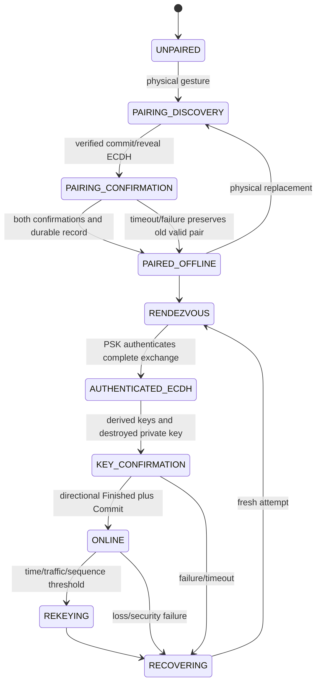

# Low-profile wireless protocol v3

> **Target plan (2026-10-06):** ESP32-S31 is the intended final wireless MCU
> for helmet and Paw; C3/v3 is retained as legacy development/regression.
> Current production sources remain v3. Public S31 preview builds and a 48 KiB
> ML-KEM-1024 worker have static resource evidence, but the supported-stable SDK
> and its memory-protection implementation block production S31 integration.
> The isolated [experimental v4 core](WIRELESS_V4_PROTOCOL.md) is host-tested and is never
> selected by production builds. Physical qualification is separately pending. See the
> [S31 preflight](WIRELESS_S31_PREFLIGHT.md) for evidence and remaining work.

Both ESP32-C3 targets use ESP-IDF 6.1.0 / Mbed TLS 4.1.0 PSA primitives. The old
DTLS adapter remains only for historical regression tests; it is not linked into
firmware. Teensy behavior, command IDs, Serial1 pins 0/1, 115200 8N1, COBS, CRC16,
boot epochs, freshness tickets, deduplication and execution ACKs are preserved.

## Radio boundary

Only Wi-Fi STA mode is enabled; SoftAP is excluded from the compiled driver.
There is no default STA/AP network interface, DHCP/IP service, Wi-Fi connect,
credential configuration, SSID advertising, scan, or BLE service. The first MAC
is assigned **before** Wi-Fi starts, using the documented bootloader entropy
source before Wi-Fi or ADC initialization; that source is disabled before Wi-Fi
starts. Subsequent RNG calls use active Wi-Fi hardware entropy. ESP-NOW normal operation adds exactly one
peer with `encrypt=true`, a derived 16-byte LMK, and a derived 16-byte PMK.
Broadcast peer entries exist only in bounded physical pairing and reconnect
rendezvous states. They carry public pairing commitments/reveals or authenticated
session control, never commands, telemetry, or a secret.

ESP-NOW's CCMP protection is independent of application encryption. Normal Data
frames are accepted only as unicast from the current peer address and after all
application authentication, replay, codec and directional allowlist checks.
A known/spoofed MAC confers no authority. Native send completion is never an
execution ACK. No custom raw 802.11 frame construction is used.

## Physical wireless pairing

After boot: hold helmet BOOT for 2 s and all three paw buttons for 3 s. Do not
hold BOOT across reset. Release both gestures. Each enters a 60 s window with
rapid LED blinking, suspending wireless actions but preserving local rendering.
Unpaired devices otherwise transmit nothing; they do not advertise permanently.

Each creates a fresh locally administered unicast address, ephemeral PSA P-256
keypair, and 16 random bytes. First broadcast a SHA-256 commitment to protocol
version, role, temporary address, public key and random contribution. Lock the
first opposite-role commitment for this attempt; send public-key/random reveals
only to that candidate. Verify the reveal against the locked commitment, then
perform PSA ECDH. The canonical transcript is paw material then helmet material.
HKDF-SHA-256 with its SHA-256 digest as salt and separately labelled information
derives a 32-byte pairing secret and the short authentication code (SAS).

Compare **all six decimal digits** on both LEDs. One long pulse marks a repeat;
each of six groups has short flashes for its digit, zero represented by ten
flashes, with a longer inter-digit gap. Leading zeros matter. Start pairing with
the devices together and observe a complete repeat on each. Codes are never
printed. If codes differ, let the window expire and start again; do not confirm.
The commitments prevent choosing a random contribution after seeing the other's
reveal; checking the SAS provides the missing first-use identity authentication.

If codes match, hold each gesture again for 1 s after release. Local confirmation
is independent on each unit and cannot be sent by radio or console. Exchange
transcript-bound HMAC-SHA-256 confirmations with the pending secret. Neither unit
stores until **both** confirmations are present. NVS uses one atomic versioned
blob; no partial multi-key record. Repeat the confirmation for 2 s after saving,
then leave pairing and automatically establish a session. Ephemeral private keys
are destroyed after agreement; the stored secret identifies the paired opposite-role peer by possession rather than a permanent MAC. Temporary secrets are wiped on timeout/completion.

Pairing is deliberately not a distributed atomic storage transaction. Power loss
or a storage error can leave only one unit committed; this fails disconnected,
never trusted. Restart physical pairing on both units to replace the secret.
A window timeout before committing preserves the previous pair. On a mismatched
SAS, neither unit should be confirmed. A first-commit attacker can cause denial
of this attempt, but cannot cause a persistent lockout or pairing acceptance.

To erase without USB, hold the local pairing gesture continuously for **12 s**;
that unit clears its pair and restarts. Erase/re-pair both units when retiring a
peer. Optional physically unlocked `FORGET` does the same locally. `PAIR` USB
key injection was removed and `pair-paw.py` only prints migration guidance.
Old v1 factory-address/USB records are intentionally not accepted; pair again.

## Authenticated ephemeral reconnect

Wire version **3** is mandatory. There is no v2 downgrade or cipher negotiation.
The valid atomic schema-2 NVS pairing record can be retained on an intentional
firmware upgrade of both peers: its random PSK is only an authentication secret.
Old radio records are rejected. No operational session is persisted or resumed.

Every session, including initial post-pair connection, boot, loss, reset, time
renewal and channel recovery, uses new PSA ephemeral P-256 keypairs and hardware
random nonces. **Handshake revision 2 requires both C3 peers to be upgraded.**
DATA wire version3, 128-byte packet size, pairing storage and Teensy framing remain
unchanged; new control types9/10/11 make old peers reject admission explicitly.
Legacy Hello1 is rejected, with no insecure fallback. Pairing PSKs need not be
erased. Experimental v4 remains excluded.

1. **Request9**, paw broadcast: P-256 uncompressed public key65 at offset4,
   nonce16 at69, temporary MAC6 at85, revision2 at91, zeros92–95; full HMAC32
   at96 over bytes0–95. A request cannot own an expensive helmet candidate.
2. **Challenge10**, helmet unicast: SHA256(Request bytes0–95) at4, current live
   helmet admission nonce16 at36, helmet MAC6 at52, revision2 at58, zeros59–95;
   HMAC32 at96 over bytes0–95. Paw accepts only a challenge bound to its locally
   fresh Request. Replaying an old challenge cannot pin a new paw attempt.
3. **Proof11**, paw unicast: Request layout with type11; HMAC32 authenticates
   Challenge bytes0–95 followed by Proof bytes0–95. Helmet reconstructs the
   challenge using its current nonce and Request hash. It reserves two ECC
   credits atomically, rotates/consumes the live nonce before expensive work,
   and only then creates/replaces its candidate. Insufficient credits preserve
   both the current candidate and proof eligibility. An exact accepted Proof
   retry uses the cached response without new ECC or extending the lifetime.
4. **Response2**, helmet unicast: its P-256/nonce/MAC contribution in the same
   key layout. SHA256(Challenge prefix96 || Proof prefix96 || Response prefix96)
   is the canonical transcript digest; Response HMAC authenticates that digest.
   Admission HMAC keys use separate HKDF(PSK, empty salt, label,32) labels
   `protogen/v3/handshake/r2/request`, `/challenge`, `/proof`, `/response`.
5. After validating the peer's contribution, both compute P-256 ECDH and derive
   the independently labeled outputs below using this transcript as HKDF salt.
   Private handles and raw shared secret are destroyed immediately. Admission
   keys/nonce/reply hashes are wiped at completion or clearing; candidate traffic
   keys are wiped after installation or failure.
6. **Paw Finished3 → Helmet Finished3 → Paw Commit8** use transcript digest32
   at4, session ID8 at36, zeros44–95 and full32-byte HMAC with separately derived
   ECDH confirmation keys. Direction/role/type are authenticated. Helmet requires
   Commit before ONLINE. Paw is eligible only after queuing Commit; both wait
   for native send completion before reconfiguring the radio. Invalid tags do
   not abort a valid pending exchange or reset its timeout.
7. Install new MACs, CCMP LMK/PMK and AES-GCM material, clear candidates and enter
   ONLINE. Only then dispatch operational DATA.

The loss-free exchange has **seven128-byte frames (896 application bytes)**,
with Request broadcast and six unicast frames. Each device still performs one
P-256 generation and one agreement. A captured Request can elicit only a cheap
challenge; a captured Proof cannot pass a different live nonce after acceptance,
restart or timeout. Four fixed hash/source FIFO entries bound challenge storage,
coalesce queued duplicates and send at most one challenge per5ms. Link applies
backpressure before dequeuing RX when this FIFO is full, so a delivered live
request is retained rather than discarded behind replayed requests.

Attempts expire after4s and retry with fresh keypairs. Each accepted fresh stage
starts its bounded confirmation interval; duplicates/invalid packets do not
renew it. A newer authenticated live Proof may supersede a stale candidate.
The historical eight-second Hello replay cache is no longer an admission rule.

An acknowledgement can still be lost: distributed link readiness cannot be made
atomic over a lossy radio. Paw has verified both directional proofs before it
queues Commit, but helmet remains offline if Commit is lost. Native transport
success is not remote receipt or execution. No helmet command dispatch occurs
before its verified Commit. Timeout/recovery obtains entirely new keys.

### Exact key hierarchy and forward secrecy

All outputs use the raw 32-byte P-256 ECDH result as HKDF input secret and the
32-byte canonical transcript digest as salt; nonce contributions and protocol
context are already inside that digest. Information labels and output sizes:

| Label | Bytes |
| --- | ---: |
| `protogen/v3/session/ecdh/paw-to-helmet/aes-gcm` | 32 |
| `protogen/v3/session/ecdh/helmet-to-paw/aes-gcm` | 32 |
| `protogen/v3/session/ecdh/id` | 8 |
| `protogen/v3/session/ecdh/recovery` | 32 |
| `protogen/v3/session/ecdh/esp-now/lmk` | 16 |
| `protogen/v3/session/ecdh/esp-now/pmk` | 16 |
| `protogen/v3/session/ecdh/identity/paw` | 6 |
| `protogen/v3/session/ecdh/identity/helmet` | 6 |
| `protogen/v3/session/finished/paw` | 32 |
| `protogen/v3/session/finished/helmet` | 32 |
| `protogen/v3/session/finished/paw-commit` | 32 |

Pairing independently uses `protogen/v3/pair/long-term`, `/sas`, and
`/confirmation` (confirmation derived from the candidate secret, transcript as
salt). Recovery uses `protogen/v3/recovery/channel-order`. No label is reused
between purposes. No old session identity is deliberately recycled.

Later extraction of the persistent pairing secret alone does not provide the
ECDH result needed to decrypt previously recorded completed sessions. This is
forward secrecy under the P-256/HKDF assumptions, secure randomness, successful
private-key destruction and absence of earlier endpoint compromise. Host tests
check fresh keys, rejection of old recordings and failure of PSK-only derivation;
they are not a mathematical proof or validation of physical RAM remanence,
side channels or hardware entropy. Compromise during a session exposes its keys;
PSK compromise permits future impersonation until deliberate re-pairing.

Renew after **1,000,000 authenticated records total across both directions**,
15–17 randomized minutes, or transmit sequence within 1,024 of 2^63−1. The codec refuses further AEAD processing at the record threshold.
This is far below GCM's commonly cited 2^32 invocation ceiling; at this low data
rate the time bound ordinarily wins. Renewal is coordinated by an encrypted paw
status request when possible; any hard safety threshold can initiate local
recovery without a usable channel. The time deadline permits at most a 1.5 s
active tail. An empty/failed session cannot reset a counter under the immediately
preceding traffic keys; fresh ECDH is the only production session creator.

## Fixed encrypted data envelope

All multibyte values are little endian; no packed C struct is sent.

| Offset | Bytes | Value |
| --- | ---: | --- |
| 0 | 1 | Magic 0x70 |
| 1 | 1 | Protocol 3 |
| 2 | 1 | Data type 7 |
| 3 | 1 | Sender role (helmet 1 / paw 2) |
| 4 | 8 | Session ID |
| 12 | 8 | Directional monotonically increasing sequence |
| 20 | 92 | AES-256-GCM ciphertext |
| 112 | 16 | Full GCM authentication tag |

The full 20-byte header is AAD. Plaintext: two-byte length followed by the existing
raw HelmetLink v1 frame (18–90 bytes, including CRC16); unused space is filled
with hardware randomness **before encryption**. Native CCMP overhead is outside
this 128-byte application payload. BOOP, navigation, mic/sleep, ACK, heartbeat,
battery, status request and response all have this same radio payload length.

GCM nonce = `0x70, version, sender-role, 0, sequence-as-8-bytes`. Direction keys
are separate and unique per fresh session. Sequence starts at one and stops at
2^63−1; no wrap. A retry at the transport layer reuses the exact ciphertext;
a new application retry receives a new GCM sequence. Replay prefilter rejects
zero, >2^63−1, old session IDs, duplicates, and age >=64. Decryption, CRC/length
and command-field checks precede marking the replay bitmap and dispatch. The
Teensy separately rejects old command sequences, modified retries and stale
epoch/tickets; authenticated out-of-order commands cannot execute backwards.

Control frames remain 128 bytes. Types: legacy/rejected Hello1, Response2, Finished3,
PairCommit4, PairReveal5, PairConfirm6, DATA7, Paw Commit8, Request9,
Challenge10, Proof11. Public-key control
bodies and Finished layouts are specified above. PairCommit body: 32-byte digest;
PairReveal: public key 65, nonce 16, source MAC 6; PairConfirm: transcript hash 32,
physical-confirmation flag 0/1. Operational parsers never execute control frames.

Wireless-only Status body variants: paw length 0 requests fresh status; length 1
with byte 1 requests rekey; length 4 reports cell millivolts (0 unknown, max 6000)
and sensor faults. Helmet length 24 extends the unchanged 20-byte Teensy status
with remaining battery percent (0xffff unknown) and sensor faults. The original
20-byte status is also accepted. These variants never pass through UART as
commands. Unsupported kinds/actions/values are rejected before forwarding.

## Identity, channel recovery and timing

Session MACs are derived from the authenticated transcript. Set bit 1 of the
first octet (locally administered), clear bit 0 (unicast). Reserve opposite last
address bits for the two roles so they cannot collide with one another. There
are 45 random address bits per role: collision with unrelated equipment remains
possible, not detectable with certainty without extra RF discovery. Pair-specific
keys and randomness make accidental collision unlikely; a new handshake changes
addresses on recovery. Factory MACs are neither required nor stored nor logged.

Recovery starts with random addresses and a keyed permutation of channels
1/6/11. Derive the permutation with HKDF label
`protogen/v3/recovery/channel-order`. After link loss, use the last authenticated
session's recovery key for 15 s, then the pairing secret for reboot-compatible
fallback. Boots start with the pairing secret. During a prolonged outage the temporary
rendezvous MAC rotates after 30 s (up to 4 s grace for a pending handshake),
without resetting the channel schedule. An absent peer therefore does not leave
a disconnected transmitter indefinitely on one address. The paw sweeps every 400 ms while
the helmet dwells 2400 ms. Asymmetric dwell guarantees channel overlap without
shared boot time or an RTC, provided at least one configured channel is usable;
repeated pending handshakes freeze the channel for at most 4 s. The handshake
pins the successful channel. Rates and dwell times are centralized in
`WirelessConfig.h`; no currently failing channel message is needed to coordinate
fallback. Some permutations necessarily resemble 1/6/11: this is a keyed order,
not an anti-jamming or secret-frequency claim. Native driver channel changes and
radio stop/start races require physical qualification.

Idle paw keepalives are encrypted status requests every random 3–5 s, with one
fresh status response. Helmet status changes may also be pushed (selection,
flags, features and faults); changing ADC readings alone do not cause idle RF.
Optional paw battery telemetry occurs every 20 s. Button gestures request status
immediately; poll every 100 ms during use and for 1.5 s afterwards. Pending
commands use unchanged ticket/sequence retries at 100 ms within the 300 ms
Teensy freshness limit. A four-intent queue bounds rapid presses; aged intents
expire instead of executing late. A cold first action may wait one status
round-trip. No stale held-button action executes after reconnect: release all
buttons to arm.

After 6 s without authenticated receive, use 100 ms probes until the 12 s
link-loss threshold. The helmet's **wired** 500 ms heartbeat preserves the
Teensy's existing 2 s UART timeout without RF traffic. On radio loss the helmet
stops that heartbeat; Teensy paw-online indication clears within another 2 s.
Rendering and local buttons continue in their current safe state throughout.
Antenna conditions, driver ACKs and latency affect recovery; 12 s sacrifices the
old 2 s disconnect display for quieter idle traffic. Usable spectrum loss causes
continued bounded recovery attempts and local-control fallback, not repeated
commands or frozen rendering. This does not defeat broadband jamming.

## Parser, resource and SDK boundaries

Wi-Fi callbacks check fixed envelope fields and copy to an8-slot queue. In
operational mode they admit only unicast DATA from the published peer; offline
mode admits control traffic without prematurely filtering legitimate recovery.
A short critical section publishes a coherent peer/mode/generation snapshot;
queue operations stay outside it. Stale-generation entries are drained before
use. This is defense in depth, not proof of a physically reproduced RF exploit.
[Espressif's ESP-NOW documentation](https://docs.espressif.com/projects/esp-idf/en/stable/esp32c3/api-reference/network/esp_now.html)
states that unencrypted unicast/broadcast may arrive without adding a peer,
whereas encrypted unicast requires the matching peer/LMK; callbacks run on the
Wi-Fi task and must remain short.

Recovery consumes at most4 received records per2ms, including notification storms;
unread records remain queued during the service cooldown or challenge FIFO
backpressure. Handshake bad tags consume bounded short HMAC work without taking
a global verification credit or triggering failure backoff. Pairing retains its
original verification/backoff policy. ECC generation/agreement still share a
bucket: burst4, refill one per500ms. Helmet admission reserves its two credits
atomically. Attempt creation remains burst2/refill1s; pairing retains its
one-agreement/s gate. ONLINE DATA authentication remains at most200/s and
independent of handshake traffic. Invalid Finished/Commit cannot clear a pending
candidate. This bounds software work and gives delivered legitimate traffic
progress under the tested bounded floods; queue saturation and RF jamming can
still prevent delivery. Four outgoing slots and one ciphertext retry slot
bound memory. PSA internals may allocate; application hot paths allocate no
variable-size memory. Length/version/role/session/sequence checks precede copies
or expensive operations. Sustained RF flooding can deny radio service but cannot
bypass authentication; Teensy remains independent.

ESP-IDF supports `esp_wifi_set_mac(WIFI_IF_STA, ...)` and STA ESP-NOW on these C3
boards. MAC rotation is done with Wi-Fi stopped; ESP-NOW is deinitialized and
peers/queued frames are rebuilt. This avoids changing live peer addresses and
CCMP counters in place. A send-completion failure triggers a radio rebuild after
4 s. STA power save remains off for reception reliability; battery savings from
RF silence are not a validated endurance claim.

[Security scope](../SECURITY.md), [production steps](PRODUCTION_PROVISIONING.md),
[tests and physical qualification](WIRELESS_VALIDATION.md).

## Explicit security lifecycle

This diagram shows the conceptual lifecycle. Link exposes these state names;
AUTHENTICATED_ECDH is a synchronous Handshake phase, then Link moves directly
from rendezvous to key confirmation. Pairing uses one phase enum including both
confirmation combinations; Handshake uses one phase enum; Session is empty or
active. Persisted-pair presence and radio-driver availability are facts, not
independent permission booleans. Production transition checks fail closed and
safe debug assertions check internal invariants. ONLINE requires paired, active,
confirmed material and no pairing overlap. REKEYING drains only its already
validated outgoing control; inbound application dispatch is restricted to ONLINE.

## Storage, telemetry and UART

Storage remains one 46-byte schema-2 record: role, paired state, configuration,
full secret, reserved zeros, energy calibration, CRC16. Invalid length, schema,
role, reserved bits, impossible fields, absent secret or CRC fails closed and
clears the decode destination. Sensitive Config temporaries wipe on destruction.
No migration guesses; an unknown future schema requires recovery. NVS atomically
publishes the whole blob, so power loss yields old valid, new valid, or invalid/
unpaired state. CRC detects corruption, **not malicious writes by a physical
attacker**. Production hardware protections and safe update/recovery remain
required. Host fault injection models NVS's contract, not its flash implementation.

`SECURITY STATUS` exposes state, authenticated session age, record count, remaining
renewal time, channel and saturating counters for AEAD failures, replay rejection,
malformed/old-version frames, pairing failure/timeout, handshake/Finished failures,
recovery/renewal/channel changes, identity rotation, rate drops and disconnects.
No keys, tags, full nonces, SAS, factory MAC or identity history are exposed. SAS
mismatch cannot be detected locally by comparing two LEDs; it is deliberately not
fabricated as a counter. Telemetry never gates authentication.

`PROTOGEN_UART_AUTH=1` adds an authenticated Serial1 envelope around the unchanged
HelmetLink v1 packet, preserving COBS and CRC16. It is an explicit per-helmet build
feature; see provisioning documentation. Enabled endpoints never accept CRC-only
commands. ESP32 uses PSA HMAC-SHA-256; Teensy uses an unmodified upstream Mbed TLS
3.6.5 SHA-256/MD subset with isolated symbol names. A reusable MAC context allocates
once on Teensy initialization, not for every command. No custom hash/MAC is used.

UART exchange: ESP sends a full-HMAC-authenticated fresh16-byte request nonce.
Teensy replies with its boot epoch, echoed nonce and an opaque16-byte session ID.
The session ID is issue-time32 plus96 PRF bits from HMAC binding a separate
`protogen/v3/uart/challenge-id` domain, volatile CSPRNG seed16, request nonce,
boot epoch, committed generation, issue time and wrap era. These public96 bits
are **not** an authentication tag: every control/DATA frame still has the full
256-bit HMAC. No cipher or authentication algorithm was substituted.

Teensy validates a Confirm by recomputing the ID and checking its exact2s TTL;
Requests cannot replace pending candidates or deactivate the active session.
A committed Confirm increments generation, retiring prior challenges and
preventing captured confirmations from resetting DATA counters. Continuous
poll/feed tracks timer wrap era so an uncommitted recording does not become
fresh again after a49-day millis wrap. Seed generation is lazy and retried at
most once/s on entropy failure; successful Requests need only short bounded
HMAC work. Wire baud, finite parser and64-byte Teensy service budget bound that
work. The first authenticated status confirms readiness to ESP; ESP renews
after2s without valid status. SID layout is opaque to the existing ESP peer,
so this receiver change preserves the v3 UART envelope.

Raw UART envelope: magic `0x75`, version 3, direction/role, message type (4 bytes);
UART session ID (16); Teensy epoch (4); monotonic sequence (8); complete raw v1
application packet; HMAC-SHA-256 (32); CRC16 (2). Max raw length 156, encoded 158.
HMAC input is a 24-byte zero-padded `protogen/v3/uart/auth` domain followed by the
entire header and payload. Both directions use the unique per-helmet secret with
explicit role/type binding. DATA sequence starts at 1 for each fresh receiver
session ID; zero/old/duplicate/exhausted counters, wrong epoch/session/role/type,
invalid MAC, malformed application packets and unsupported actions are rejected
before execution. The existing Teensy Gate still enforces freshness and execution
deduplication. The UART is authenticated, not confidential.

The ordinary Teensy 4.0 stores this secret in ordinary firmware flash. UART
protection assumes it has not been extracted/reflashed; it does not replace
Lockable Teensy security or secure boot. When the explicit feature is disabled,
CRC-only UART retains the documented physically trusted wire boundary. Production
must either enable and qualify per-helmet authentication or explicitly accept
that trusted-wires limitation. No universal key or automatic downgrade exists.
