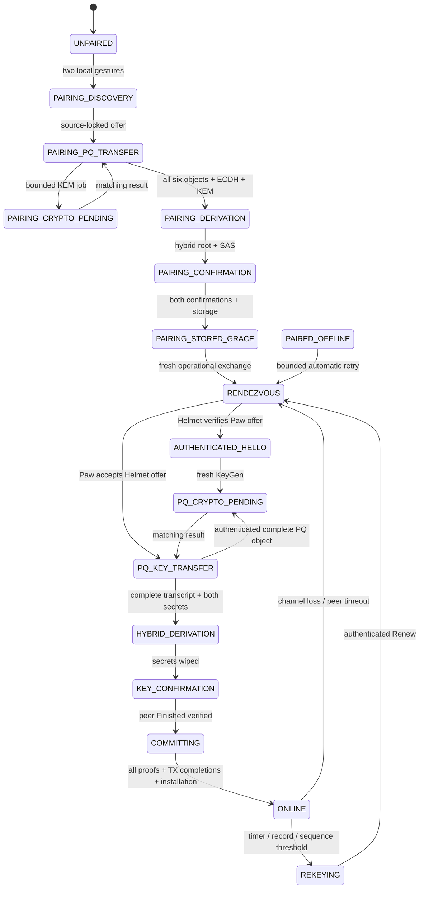

# Experimental hardware-independent wireless Protocol v4

**EXPERIMENTAL / HARDWARE-INDEPENDENT / NOT ACTIVE PRODUCTION FIRMWARE.**
The active C3 firmware still implements v3 with unchanged bytes and behavior.
There is no negotiation, downgrade, production selection or ESP-IDF component
for this core. S31 is the intended future controller; its integration is blocked
on an officially supported SDK with completed, reviewed platform hardening.
See [implementation](WIRELESS_V4_IMPLEMENTATION.md),
[validation](WIRELESS_V4_VALIDATION.md) and [hardware gates](WIRELESS_V4_HARDWARE_GATES.md).

## Cryptographic construction and its scope

The fixed suite is ephemeral P-256 ECDH and final FIPS 203 **ML-KEM-1024**:
encapsulation key 1,568 B, decapsulation key 3,168 B, ciphertext 1,568 B,
shared secret 32 B. Helmet generates a new ML-KEM keypair for every pairing and
session. Paw encapsulates once to that public key. Both endpoints generate new
P-256 keys, 16-byte nonces and temporary unicast identities for every exchange.
KEM work occurs only during pairing, reconnect and renewal.

Standards reviewed on 2026-10-06:

* [FIPS 203 final](https://csrc.nist.gov/pubs/fips/203/final), August 2024, and its
  currently published November 17, 2025 potential errata: Appendix A zeta indexing
  and Algorithm 15's polynomial comment. These are clarifications, not a switch
  to pre-standard Kyber. Errata workbook SHA-256:
  `edf899c89762449f43d7713883caeefc2e4ae9ae98d5a76b339547db22cb3ac7`.
* [SP 800-227 final](https://csrc.nist.gov/pubs/sp/800/227/final), September 2025,
  particularly §§4.6.2–4.6.3, equations (14) and (15).
* [SP 800-56C revision 2](https://csrc.nist.gov/pubs/sp/800/56/c/r2/final),
  §4.1, one-step KDF option 1, and its hybrid shared-secret treatment.

The combiner is the standardized one-step hash KDF, using approved SHA3-256
with output length L=256. It is **not** a new XOR or bespoke extractor:

```text
Z = SS_ECDH[32] || SS_MLKEM[32]
FixedInfo = ASCII("protogen/v4/hybrid/p256-mlkem1024/sha3-256\0")
            || BE32(256) || BE32(length(T)) || T
Root = SHA3-256(BE32(1) || Z || FixedInfo)
TH = SHA256(T)
output(label, n) = HKDF-SHA256(IKM=Root, salt=TH,
                              info=ASCII(label), length=n)
```

This implements SP 800-227's approved multi-secret KDM construction. Both
secrets enter the same KDF; all classical/PQ public material and unambiguous
context enter FixedInfo. SHA3-256 and complete public inputs follow the hash
combiner rationale in §4.6.3. One surviving independent high-entropy contribution
is intended to protect the output under the KDF/hash assumptions. If P-256
becomes quantum-breakable, ML-KEM supplies the remaining secret. If ML-KEM is
broken, authenticated fresh P-256 supplies protection against classical attackers.

These are conditional claims, not a formal IND-CCA proof for arbitrary component
substitution: P-256 ECDH is an authenticated ephemeral key agreement, not itself
an IND-CCA KEM. SP 800-227 explicitly cautions that mere concatenation into a
KDF does not establish generic CCA robustness. The approved KDF construction
does not confer FIPS module certification or imply NIST approved this complete
application protocol. SAS, PSK authentication, full transcript binding and
Finished are necessary parts of this protocol's active-attack protection.

## Exact canonical transcript

All multibyte **wire** integers are little endian. The KDF counter, L and
transcript length above are explicitly big endian. No compiler struct layout is
serialized. Complete T is exactly **3,825 bytes**, in this order:

| Field | Bytes | Value |
|---|---:|---|
| domain | 23 | ASCII `protogen/v4/transcript` followed by NUL |
| context | 8 | `70 04 mode 02 01 01 00 04`; Paw, Helmet, combiner ID 1, LE16 parameter 1024 |
| exchange identifier | 8 | Paw's random nonzero uint64 |
| six objects | 3,786 | ordered entries described below |

Each entry is `normalized_fragment_header[28] || SHA256(body)[32] || body`.
The normalized header sets fragment index and payload length to zero; all
reserved bytes remain zero. This binds fragment type, count, total size, roles,
mode, generation identifier and source identity without binding delivery order
or duplicate retransmissions. Fragment tags are verified separately and are
not cyclically included in the transcript. The six objects are:

| ID | Object / sender | Body bytes |
|---:|---|---:|
| 0 | Paw offer / Paw | 129 |
| 1 | Helmet offer / Helmet | 129 |
| 2 | ML-KEM encapsulation key / Helmet | 1,568 |
| 3 | ML-KEM ciphertext / Paw | 1,568 |
| 4 | Paw nonce / Paw | 16 |
| 5 | Helmet nonce / Helmet | 16 |

An offer is SEC1 uncompressed P-256 public key[65], nonce commitment[32],
encapsulation-key hash[32]. Paw's last field is zero. Helmet's is SHA256 of
its complete ML-KEM public key. The nonce commitment is
`SHA256(normalized_nonce_header[28] || P256_public[65] || key_hash[32] || nonce[16])`.
Public exchanges and committed nonce values are frozen before nonce reveals.
The entire received object is immutable, including after reassembly finishes.

The local monotonic worker generation is not a network timestamp. It labels
jobs/completions and invalidates cancelled candidates. The radio identifier is
fresh random material and is bound to both fresh temporary identities. Neither
is a persistent device identity. Random-collision resistance depends on the RNG;
the 64-bit radio identifier alone is not the sole session uniqueness mechanism.

## Physical pairing

1. Local gestures independently open a 60-second window at both endpoints.
   Each endpoint leaves operational traffic; pairing and ONLINE cannot overlap.
2. Paw sends its fresh offer. Helmet source-locks a bounded candidate, generates
   a fresh KEM keypair in the worker, then sends its offer and public-key object.
3. Paw verifies the complete key's commitment, validates the peer P-256 point,
   performs ECDH and encapsulation, and sends the ciphertext and nonce reveal.
4. Helmet reassembles the ciphertext, performs ECDH and decapsulation, and
   reveals its previously committed nonce. Both verify nonce commitments and T.
5. The hybrid root derives separate `protogen/v4/pairing/secret` (32 B),
   `/sas` (32 B), `/id` (8 B), `/confirm/paw` and `/confirm/helmet` (32 B each).
   SAS is LE24 of SAS material modulo 1,000,000, displayed as **six digits**.
   Users compare the entire code, including leading zeroes, before confirming.
6. Only a local API call can mark local physical confirmation. Each endpoint
   authenticates its peer's confirmation using that peer's new confirmation key.
   Both confirmations and local write/readback must succeed before persistence.
7. A bounded two-second confirmation retransmission grace then destroys pairing
   material and starts an entirely fresh hybrid operational session. Pairing keys
   are never installed as operational traffic keys.

Initial fragment hashes are **untrusted commitments**, not per-fragment peer
authentication. Source locking, commitments, bounded windows and work budgets
limit attacks; transcript-bound SAS and independent local confirmation establish
trust. The code has approximately 20 bits of active substitution detection per
attempt, with slight modulo bias; it is not a 256-bit human authentication code.
Timeout/mismatch/cancellation fails the candidate. An attacker can deny service.

## Every reconnect and renewal

Paw's Hello is its complete, PSK-authenticated offer. Helmet authenticates and
reassembles it before submitting KeyGen or generating its P-256 key. Separate
pre-session keys are HKDF-SHA256 of the persistent **v4** pairing secret with
empty salt and `protogen/v4/handshake/auth` or `/handshake/fragments`.
All fragments include the current exchange identifier and source in the HMAC.
Offers use the first key; PQ/nonce objects use the second. No traffic key is
used during establishment. Paw authenticates the complete public key before
encapsulation; Helmet authenticates the complete ciphertext before decapsulation.

The hybrid exchange otherwise follows pairing steps 2–4. Both derive session
material, wipe raw secrets and ephemeral handles, then perform:

```text
Paw Finished → Helmet Finished → Paw Commit → Helmet CommitAck
```

Every control message is an HMAC of its first 96 bytes, with its own role's
fresh key. It contains v4, role/direction, exchange ID, source identity, TH and
new session ID. Installation requires verified peer Finished, successful local
Finished transmit completion, verified peer Commit/ack, and successful local
Commit/ack transmit completion, in addition to both crypto contributions and
derivation. DATA cannot dispatch until ONLINE. Lost final acknowledgements can
leave one endpoint temporarily ONLINE; bounded timeout creates a fresh exchange.
No last-message scheme can guarantee simultaneous transitions over a lossy link.

Renewal uses a GCM-authenticated Renew record, then discards the old operational
session and runs this complete fresh handshake. Timed renewal is uniformly
selected in 15–17 minutes; record renewal begins at 999,999 authenticated records,
leaving a record for the renewal notice, and sequence renewal reserves 1,024
values below `0x7fffffffffffffff`. There is no lightweight classical rekey.

## Key hierarchy

All labels below are prefixed `protogen/v4/session/` and use Root and TH above.

| Suffix | Bytes |
|---|---:|
| `paw-to-helmet/aes-gcm`, `helmet-to-paw/aes-gcm` | 32 each |
| `id` | 8 |
| `recovery` | 32 |
| `esp-now/lmk`, `esp-now/pmk` | 16 each |
| `identity/paw`, `identity/helmet` | 6 each |
| `finished/paw`, `finished/helmet` | 32 each |
| `finished/paw-commit`, `finished/helmet-commit-ack` | 32 each |
| `handshake/auth`, `handshake/fragments` | 32 each |

Identity byte 0 is forced to locally administered/unicast; Paw's final byte is
odd and Helmet's even. The session handshake keys are separated outputs reserved
for session-authenticated purposes; they do not replace PSK-derived pre-session
authentication. Finished keys are wiped after installation. No raw shared secret
is an AES key. Rendezvous uses keyed permutations of channels 1/6/11, Paw's
400-ms scan and Helmet's 2,400-ms dwell, with fresh identities. A source lock freezes
the channel during an exchange. Recovery can prefer a fresh recovery secret for
15 seconds, then uses the pairing secret. Keepalives are jittered 3–5 seconds.

## Exact fragmentation and control frame format

Every handshake frame is 128 B, bounded independently of DATA.

| Offset | Bytes | Fragment meaning |
|---:|---:|---|
| 0 | 1 | magic 0x70 |
| 1 | 1 | version 4 |
| 2 | 1 | message type 10 (handshake object fragment) |
| 3 | 1 | sender role, Helmet 1 / Paw 2 |
| 4 | 1 | mode, pairing 1 / session 2 |
| 5 | 1 | object type 0–5 |
| 6 | 1 | zero-based fragment index |
| 7 | 1 | exact fixed fragment count |
| 8 | 2 | exact object length, LE16 |
| 10 | 1 | exact payload length |
| 11 | 1 | reserved zero |
| 12 | 8 | exchange identifier, LE64 |
| 20 | 6 | source temporary identity |
| 26 | 2 | reserved zero |
| 28 | 68 | payload, zero padding after actual payload |
| 96 | 32 | session: HMAC-SHA256(bytes 0–95); pairing: SHA256(complete object) |

Each 1,568 B public key/ciphertext takes **24 fragments**, last payload 4 B.
Each offer takes two fragments, last payload 61 B; each nonce takes one.
The six objects need at least **54 frames / 6,912 radio payload bytes**.
Session Finished/Commit adds four frames: ideal **58 frames / 7,424 B** before
retransmissions, native radio headers and CCMP overhead. Pair confirmation adds
two frames and a bounded retransmission grace, followed by a separate fresh
session. Host frame counts include retransmissions; hardware airtime is unmeasured.

Only one fixed 1,568 B reassembly buffer is active per endpoint. Timeout is
1,500 ms from the first accepted fragment, not extended by duplicates. Exact
counts/lengths, zero padding, roles, state, generation and source are checked
before HMAC. Identical duplicates are idempotent; conflicting contents or object
metadata destroy the candidate. Incomplete objects cannot schedule a KEM.
Authentication failure, timeout, reset, rotation, channel loss or cancellation
clears reassembly; old sets cannot resume under a new candidate.

Control message types: PairConfirm 20, PawFinished 21, HelmetFinished 22,
Commit 23, CommitAck 24. Their header is the same except object byte=255,
index/count=0 and exact length/payload length=40 (PairConfirm=41). Body at offset
28 is TH[32] and session/pair ID[8]; PairConfirm adds local-confirmed byte 1.
The remainder through byte 95 is zero; HMAC occupies 96–127.

DATA 32 and Renew 33 remain exactly **128 B**: magic/version/type/role[4],
session ID[8], sequence LE64[8], AES-256-GCM ciphertext[92], tag[16]. The
20-byte header is AAD. Nonce is `70 04 role 00 || sequence_LE64`.
Plaintext is payload length LE16, existing bounded HelmetLink packet, and random
padding. Renew has no application packet. The 64-entry replay window and
directional application allowlist are enforced before dispatch. Native encrypted
unicast/CCMP must be attested by the transport adapter; the host core cannot
implement or prove the radio hardware's CCMP behavior.

## State transitions



Failure from a candidate returns to PAIRED_OFFLINE if a valid pairing remains,
otherwise UNPAIRED, V3_REPAIR_REQUIRED or RECOVERY_REQUIRED. Session retries use
a 250-ms backoff and replenishing budgets; there is no permanent radio lockout.
The `Recovering` enum is reserved; recovery immediately clears the candidate and
enters the corresponding offline/rendezvous state. Debug assertions supplement
runtime gates; release installation checks all seven proof bits explicitly.

## Migration and security claim

v4 rejects every v3 radio frame. A valid legacy schema-2/CRC v3 record yields
**V3_REPAIR_REQUIRED**, without importing its secret. Deliberate new v4 physical
pairing is required. The 112-byte v4 schema explicitly marks final ML-KEM-1024
hybrid provenance. It never contains ephemeral or session keys.

The intended claim is **hybrid post-quantum-resistant wireless key establishment**
with fresh hybrid forward secrecy for each session. Later compromise of the
pairing PSK alone does not expose old completed session roots from captured public
traffic, assuming at least the surviving hybrid contribution remains secure,
the RNG is sound and ephemeral secrets were erased. Endpoints must be trustworthy
during establishment. Current-session compromise does not mathematically derive
unrelated previous roots. Implementations, power/EM/timing leakage, residual
memory and endpoint compromise remain outside this mathematical claim.

AES-256-GCM, HKDF/HMAC-SHA256 and eventual ESP-NOW AES-128-CCMP retain their
standard sizes. This does not provide PQ Secure Boot or Teensy firmware
authenticity, physical tamper resistance, jammer immunity or RF invisibility.
